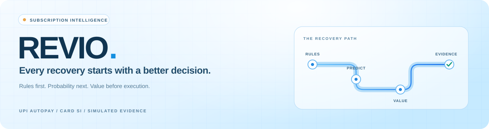
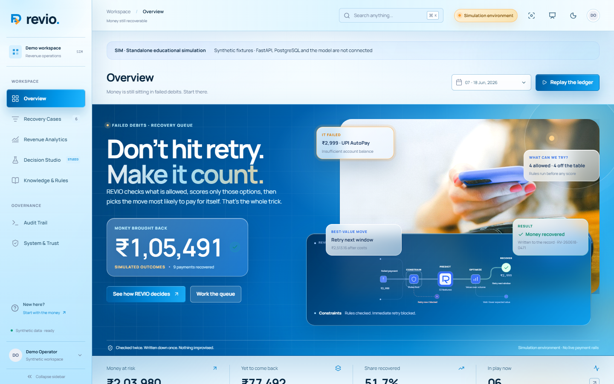
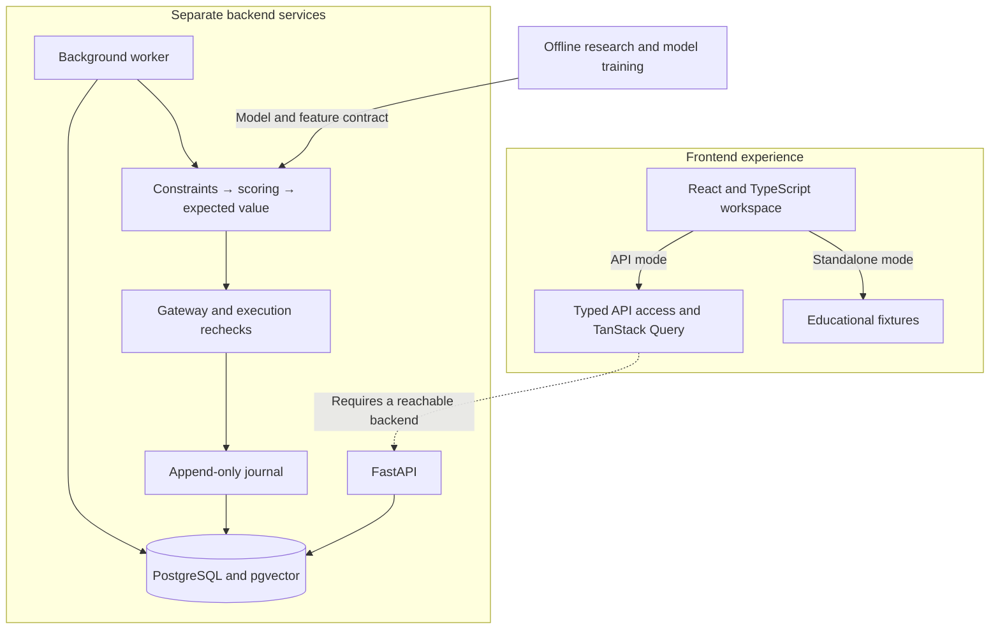

<div align="center">



# Intelligent Revenue Recovery

**Turn failed subscription payments into explainable, constrained recovery decisions.**

Built for Indian recurring-payment workflows: UPI AutoPay and card standing instructions.

[](#technology-stack)
[](#technology-stack)
[](#technology-stack)
[](#technology-stack)
[](#decision-engine)
[](#project-status)

[**Explore the frontend ↗**](https://revio-luminous.vercel.app) · [Get started](#quick-start) · [Architecture](#architecture) · [Technical guide](docs/TECHNICAL_OVERVIEW.md) · [Documentation](#documentation)

</div>

> [!IMPORTANT]
> **This is a simulation project.** Customers, payments and recovery outcomes are synthetic. The published frontend uses standalone educational fixtures. Backend API mode is implemented separately; full deployed FastAPI, PostgreSQL and model connectivity has not been verified. No displayed amount is evidence of real-world recovery performance.

## The idea

A failed debit is a decision problem. A temporary bank error, an expired card and an exhausted retry budget each need a different response.

REVIO evaluates what is permitted, estimates the chance of recovery, considers the financial cost, and selects a bounded action. The backend records why that action was chosen and rechecks permission before execution.

| Permission | Likelihood | Economics | Evidence |
| :--- | :--- | :--- | :--- |
| Deterministic constraints evaluate each candidate. | XGBoost scores eligible, label-bearing actions. | Expected value accounts for costs and scarce attempts. | Decisions, execution intents and outcomes remain inspectable. |

## Product experience



*Captured from the Arena frontend integration. The displayed figures are authored simulation fixtures.*

| Workspace | What you can explore |
| :--- | :--- |
| **Overview** | Recovery metrics, revenue pulse, money movement and baseline comparisons. |
| **Recovery Cases** | Search, filters, pagination, inspection drawers and case investigation. |
| **Decision Studio** | Decision replay, candidate evidence and an educational Scenario Playground. |
| **Revenue Analytics** | Recovery timing, failure classes, payment rails and strategy comparisons. |
| **Knowledge & Rules** | Reference context and constraint inspection, with separate authority boundaries. |
| **Audit Trail** | Journal records, search, expansion and evidence inspection. |
| **System & Trust** | Model identity, schema, fallback disclosures and runtime information. |

The Arena interface includes luminous blue surfaces, local typography, photographic storytelling, motion transitions, interactive charts, light/dark appearance, a command palette, focus mode and responsive navigation. Advanced fixture visualizations and live API evidence views have different coverage; see [project status](#project-status).

## Technology stack

| Layer | Technologies | Role in REVIO |
| :--- | :--- | :--- |
| **Interface** | React · TypeScript · Vite | Component-based workspace, typed rendering and production builds. |
| **Visual system** | Tailwind CSS · Motion · Lucide · Fontsource | Design tokens, transitions, icons, local Manrope and IBM Plex Mono fonts. |
| **Client data** | TanStack Query · Fetch API | Request caching, polling, cancellation and explicit loading/error states. |
| **Visualization** | Custom React/SVG charts · Motion | Revenue pulse, recovery flows, tooltips and decision replay. |
| **API** | Python · FastAPI · Uvicorn · Pydantic | HTTP endpoints, request validation and operational read models. |
| **Persistence** | PostgreSQL 16 · SQLAlchemy · psycopg 3 | Transactional state, execution intents, scheduling and the append-only journal. |
| **Knowledge retrieval** | pgvector · hashed-lexical embeddings | Reference search kept separate from model features and executable rules. |
| **Model runtime** | XGBoost · NumPy · YAML registries | Native categorical inference, feature validation, artifact checks and declared fallback. |
| **Offline research** | Pandas · NumPy · scikit-learn · Optuna | Data preparation, grouped evaluation and model tuning. |
| **Delivery** | Vercel · Docker Compose · nginx | Frontend hosting and a separate container topology for backend services. |
| **Verification** | TypeScript · Playwright · pytest · Hypothesis · Ruff | Build checks, browser workflows, domain tests, property tests and linting. |

Frontend technologies describe the merged Arena release, whose custom charts replace the older README's Recharts reference. The backend package declares **Python 3.11+**; its container uses **Python 3.12**. Exact dependency ranges live in the [merged frontend package](https://github.com/Sohamgaonkhadkar/REVIO---Intelligent-Decision-Engine-for-Subscription-Revenue/blob/main/recoverydesk/apps/web/package.json) and [backend pyproject.toml](recoverydesk/pyproject.toml).

## Architecture



**PostgreSQL is authoritative for backend operation.** The standalone frontend's educational ledger is a separate data mode. Deploying the Vite site to Vercel does not deploy the API, database, worker or XGBoost runtime.

### Decision engine

```text
Payment failure
  → Generate bounded candidate actions
  → Apply deterministic constraints
  → Score eligible label-bearing candidates
  → Rank by expected value
  → Select an action or a control path
  → Recheck permission at the gateway
  → Record execution and outcome
```

```text
EV = p̂ × (amount at risk × margin factor)
     − action cost − channel cost − fatigue cost − attempt opportunity cost
```

| Design boundary | Implementation principle |
| :--- | :--- |
| **Rules precede inference** | Blocked candidates do not reach the model. |
| **Probability cannot grant permission** | Compliance decisions remain deterministic. |
| **Model activation is checked** | Registered artifacts and the feature contract must pass their gates; failures disclose fallback. |
| **Execution is checked again** | The gateway verifies legality and state before dispatch. |
| **Comparisons remain honest** | B0/B1/B2 results remain visible even when another strategy outperforms REVIO. |
| **Evidence remains traceable** | Journal entries connect cases, decisions, intents and outcomes. |

The model contract contains **32 features: 12 categorical and 20 numeric**. Estimates are **uncalibrated**; no calibration artifact is supplied. See the [model guide](docs/TECHNICAL_OVERVIEW.md#9-model-development-and-training) for training context and evaluation limitations.

## Quick start

### 1 · Explore the standalone frontend

Use the latest `main` checkout, which contains the Arena integration:

```bash
git clone https://github.com/Sohamgaonkhadkar/REVIO---Intelligent-Decision-Engine-for-Subscription-Revenue.git revio
cd revio/recoverydesk/apps/web
npm ci
npm run dev
```

Open the local URL printed by Vite. Standalone mode needs no backend, database or API key.

```bash
npm run build
npm run preview
```

The integrated build performs TypeScript checks and writes to `spa/`, the directory used by the FastAPI/nginx static-serving setup.

### 2 · Connect the API workspace

Configure these **public build-time settings** in the frontend's local environment file or Vercel project:

```dotenv
VITE_DATA_MODE=api
VITE_API_BASE_URL=https://your-fastapi-origin.example
```

Replace the example origin with your reachable FastAPI service. For local development, a blank base URL uses the Vite proxy at `http://127.0.0.1:8001`. Cross-origin deployment needs an appropriate backend CORS policy; a same-origin reverse proxy is another option. Rebuild after changing Vite environment variables.

API mode reads existing case, decision, execution, outcome, baseline, knowledge, constraint, audit, health and model endpoints. Failed requests display errors; they do not silently load successful fixture results.

<details>
<summary><strong>Backend development setup</strong> · Python, PostgreSQL and the worker</summary>

Run from `recoverydesk/`, with PostgreSQL 16 and pgvector available:

```bash
python -m venv .venv
# Activate .venv using your shell's activation command.
python -m pip install -e ".[dev]"
```

Set `DATABASE_URL` to your PostgreSQL connection string and `RD_ENV=sim` in the shell. Then bootstrap and run the API:

```bash
python -m db.bootstrap
python -m uvicorn apps.api.main:app --host 127.0.0.1 --port 8001
```

Run the worker in another activated shell with the same database configuration:

```bash
python -m apps.workers.loop
```

Model activation requires the registered artifact files and matching hashes. See the [runtime guide](recoverydesk/README.md) for database roles, initialization and artifact requirements. Use a dedicated development database; bootstrap and worker commands operate on the configured database.

</details>

<details>
<summary><strong>Container topology</strong> · API, database, worker and nginx</summary>

From the repository root, copy `recoverydesk/deploy/envs/dev.env.example` to `recoverydesk/deploy/envs/dev.env`. Configure `POSTGRES_PASSWORD` and `RD_MODEL_JSON` for your machine. Build the frontend first so `recoverydesk/apps/web/spa/` exists.

```bash
docker compose -f recoverydesk/deploy/docker-compose.yml --env-file recoverydesk/deploy/envs/dev.env up --build
```

| Service | Purpose | Host port |
| :--- | :--- | :--- |
| `db` | PostgreSQL 16 and pgvector | `5432` |
| `api` | FastAPI service | `8000` |
| `ops` | Background worker | — |
| `web` | nginx and API proxy | `8080` |

This is the repository's deployment topology, not a claim that these backend services are currently hosted.

</details>

> [!NOTE]
> `VITE_*` values are shipped to the browser. Database credentials, operations keys and private service credentials belong in backend configuration.

## Project status

The following is the **recorded frontend integration baseline from 15 November 2026**, not a continuously monitored health report.

| Area | Recorded status |
| :--- | :--- |
| **Arena frontend** | Integrated and published on Vercel in explicitly labelled standalone simulation mode. |
| **Frontend verification** | Production build, 10 fixture invariants and 20 workflow groups passed. |
| **Responsive checks** | Eight direct routes with refresh; 40 route/width combinations across 1440, 1280, 1024, 768 and 390 pixels passed. |
| **Assets and browser** | Local fonts/images loaded; the recorded final sweep found no browser errors, failed assets or horizontal overflow. |
| **API workspace** | Contract workflows passed against controlled responses, including backend-failure isolation. Full live database connectivity was not verified. |
| **Backend regression** | Targeted run: 40 passed, 2 failed and 2 errored with model activation unavailable. Missing dependencies and Windows artifact hash issues were documented. |
| **Backend deployment** | No stable reachable backend origin was identified during integration. |
| **Automatic Git deployment** | The Vercel account's GitHub Login Connection still needed configuration at release time. |

Some rich charts, scenario tools, saved views and drawer interactions remain specific to the educational fixture workspace. Live API views do not yet reproduce every fixture visualization. The [integration report](https://github.com/Sohamgaonkhadkar/REVIO---Intelligent-Decision-Engine-for-Subscription-Revenue/blob/main/recoverydesk/apps/web/INTEGRATION.md) documents exact coverage and unresolved work.

## Verification

From the integrated `recoverydesk/apps/web/` directory:

```bash
npm run build
npm run test:integrity
node tests/interactions.mjs
node tests/visual-check.mjs
```

Browser scripts use installed Chrome by default and expect a running frontend. `BASE_URL` selects a deployment or local server; `PLAYWRIGHT_CHANNEL` selects another browser channel. API contract tests use a separate API-mode dev server and controlled endpoint responses.

From `recoverydesk/`, with development dependencies and a dedicated test database configured:

```bash
python -m pytest tests
python scripts/verify_model_runtime.py
```

Stop the background worker before database tests so it does not race test fixtures. Passing fixture or mocked-API tests does not establish live database correctness, model activation or production payment performance.

## Repository map

```text
REVIO/
├── README.md                           Project entry point
├── docs/
│   ├── assets/                         README visuals
│   └── TECHNICAL_OVERVIEW.md            Preserved research and system narrative
├── recoverydesk/
│   ├── apps/api/                       FastAPI endpoints
│   ├── apps/web/                       React/TypeScript frontend
│   ├── apps/workers/                   Background worker
│   ├── core/                           Constraints, scoring, EV and orchestration
│   ├── db/                             Migrations, roles and bootstrap
│   ├── configs/                        Rule packs and registries
│   ├── artifacts/                      Registered model files and reports
│   ├── sim/                            Simulated world
│   ├── adapters/                       Payment and notification boundaries
│   ├── deploy/                         Docker Compose and nginx
│   └── tests/                          Backend tests
└── revenue-recovery-model-trainng/      Research, datasets, EDA and model training
```

## Documentation

| Read this | For |
| :--- | :--- |
| [Technical overview](docs/TECHNICAL_OVERVIEW.md) | The preserved 29-section research, architecture and evaluation narrative. |
| [Runtime guide](recoverydesk/README.md) | Backend setup, operational boundaries and system implementation. |
| [Architecture decisions](recoverydesk/DECISIONS.md) | Recorded tradeoffs and deviations from earlier specifications. |
| [Evaluator walkthrough](recoverydesk/EVALUATOR_WALKTHROUGH.md) | The original backend-oriented demonstration workflow. |
| [Data provenance and test evidence](recoverydesk/DATA_PROVENANCE_AND_TEST_EVIDENCE.md) | Source lineage and recorded verification evidence. |
| [Frontend integration report](https://github.com/Sohamgaonkhadkar/REVIO---Intelligent-Decision-Engine-for-Subscription-Revenue/blob/main/recoverydesk/apps/web/INTEGRATION.md) | Arena feature mapping, API coverage, deployment and limitations. |
| [Documentation index](DOCUMENTATION_INDEX.md) | Research phases, implementation references and supporting documents. |

---

<div align="center">

**Rules before scores. Value before action. Evidence after every step.**

<sub>REVIO · Intelligent Revenue Recovery · Synthetic customers and payments · SIM environment</sub>

</div>
