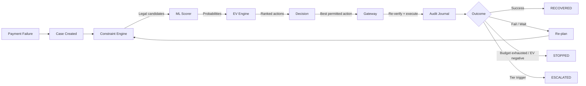
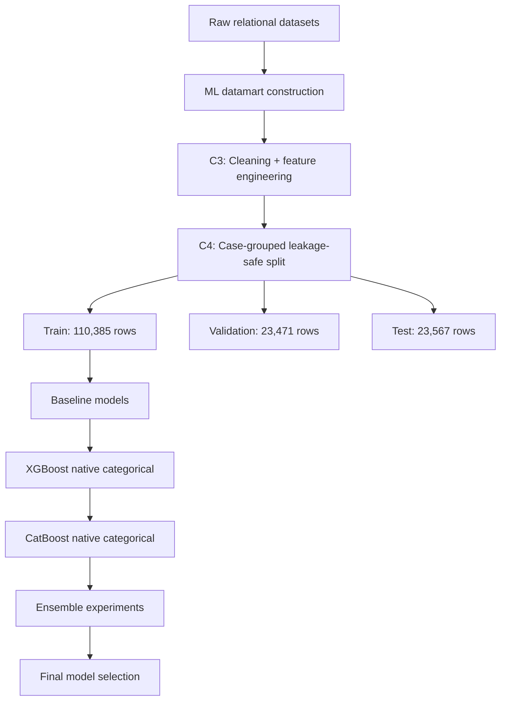
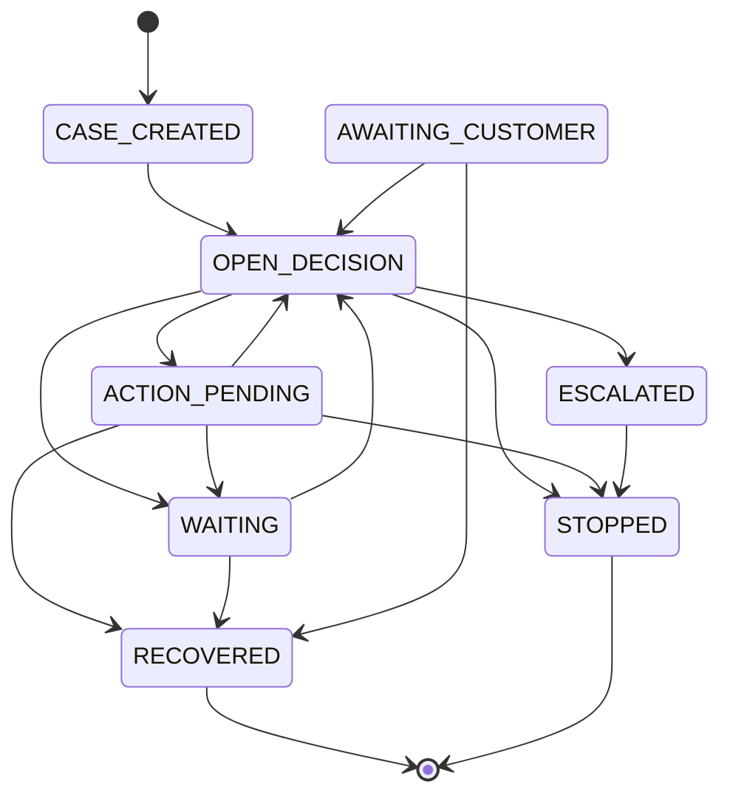

> [!NOTE]
> **Preserved technical narrative.** This document retains the earlier 29-section project write-up, including historical test counts and frontend assumptions. Those are not current deployment or test guarantees. Use the [project README](../README.md) for the merged Arena frontend, setup paths and recorded integration limitations.

# REVIO — Intelligent Revenue Recovery

**Live website:** [revio-luminous.vercel.app](https://revio-luminous.vercel.app/)

**Project description:** A compliance-first, ML-powered revenue recovery system for failed UPI AutoPay and card subscription payments. REVIO combines policy-based safeguards, XGBoost recovery scoring, expected-value action selection, and audit-ready decision logs. The demo uses synthetic data in a simulated environment.

REVIO is a bounded, compliance-first revenue-recovery system for failed recurring payments on Indian subscription rails (UPI AutoPay and card standing instructions). When a scheduled auto-debit fails, REVIO opens a recovery case, classifies the failure, evaluates candidate actions through a constrained decision pipeline — deterministic rules, then ML probability, then expected-value economics — executes the optimal permitted action, and journals every step as append-only evidence.

Everything in this repository runs against a simulated world (`env=sim`) with synthetic customers. The propensity model was trained on simulated recovery outcomes. No number produced by this system is evidence of real-world recovery performance. Every screen carries a persistent `SIM` badge; every API payload carries `env=sim`.

---

## Table of Contents

1. [Executive Summary](#1-executive-summary)
2. [Problem Definition](#2-problem-definition)
3. [Proposed Solution](#3-proposed-solution)
4. [System Architecture](#4-system-architecture)
5. [End-to-End System Workflow](#5-end-to-end-system-workflow)
6. [Data Acquisition and Dataset Construction](#6-data-acquisition-and-dataset-construction)
7. [Exploratory Data Analysis](#7-exploratory-data-analysis)
8. [Feature Engineering](#8-feature-engineering)
9. [Model Development and Training](#9-model-development-and-training)
10. [Model Evaluation and Validation](#10-model-evaluation-and-validation)
11. [Decision Architecture](#11-decision-architecture)
12. [Recovery State Machine](#12-recovery-state-machine)
13. [Backend Architecture](#13-backend-architecture)
14. [Frontend Architecture](#14-frontend-architecture)
15. [Database and Data Model](#15-database-and-data-model)
16. [Knowledge, Rules and Governance](#16-knowledge-rules-and-governance)
17. [Execution Architecture](#17-execution-architecture)
18. [Auditability and Data Provenance](#18-auditability-and-data-provenance)
19. [Product / Revenue Operations Workflow](#19-product--revenue-operations-workflow)
20. [Baselines and Outcome Measurement](#20-baselines-and-outcome-measurement)
21. [Technology Stack](#21-technology-stack)
22. [Repository Structure](#22-repository-structure)
23. [Deployment and Runtime](#23-deployment-and-runtime)
24. [Testing and Verification](#24-testing-and-verification)
25. [Dataset / Synthetic Data Policy](#25-dataset--synthetic-data-policy)
26. [Security, Safety and Operational Boundaries](#26-security-safety-and-operational-boundaries)
27. [Limitations](#27-limitations)
28. [Future Work](#28-future-work)
29. [Final System Summary](#29-final-system-summary)

---

## 1. Executive Summary

Indian subscription businesses lose revenue when scheduled auto-debit charges fail. NPCI-reported data shows that UPI AutoPay debit failure rates reached 55–90% across banks in August 2025; typical-month estimates run 8–15% for UPI AutoPay and 2–8% for card standing instructions. Each unrecovered failure risks involuntary subscription churn — churn the customer never chose. Recovery is constrained by hard regulatory limits: NPCI's 1+3 retry budget per mandate cycle, non-peak execution windows, RBI's ₹15,000 per-transaction cap, pre-debit notification requirements, and contact frequency limits.

Today, most merchants rely on their payment service provider's fixed retry schedule. These static templates apply the same cadence to every failure regardless of root cause, waste limited retry attempts on unrecoverable mandates, and terminate in a silent subscription halt.

REVIO replaces this with a per-case, intelligence-driven recovery engine. The system separates four concerns that static retry systems conflate:

1. **Rules (Legality):** What is the system permitted to do? Deterministic constraints enforce budgets, windows, and contact limits.
2. **Likelihood (ML):** If we take this action, how likely is it to succeed? An XGBoost model estimates recovery probability.
3. **Economics (Expected Value):** Is the permitted action financially worthwhile? An EV formula weighs probability against action costs and attempt scarcity.
4. **Decision:** Select the highest-EV permitted action. If no action has positive EV, stop the case.

This separation guarantees that high predictive confidence never overrides compliance constraints, and that economically negative actions are never executed regardless of their predicted success probability.

The project spans the full lifecycle from problem research through model training to a deployed operational system:

- **Problem definition and competitive analysis** (Phase 1)
- **Data and intelligence strategy** (Phase 2)
- **Dataset construction via calibrated structural simulator** (Phase 3A/3B)
- **Exploratory data analysis** (Phase 3C2B)
- **Feature engineering and ML data contract** (Phase 3C/3C3)
- **Model training, evaluation, and artifact production** (Phase 3C)
- **Deployment architecture** (Phase 4)
- **Implemented runtime system** (`recoverydesk/`)

---

## 2. Problem Definition

When a recurring payment fails, the failure is not homogeneous. A debit that fails due to `INSUFFICIENT_FUNDS` on a salary-account customer three days before payday requires a fundamentally different strategy than a failure due to `MANDATE_CLOSED` (where retrying is impossible) or `BANK_TECHNICAL` (where immediate retry has an 88% success rate in the simulated dataset).

Static retry systems fail because they ignore:

- **Failure heterogeneity.** NPCI classifies failures as business declines (insufficient balance, mandate paused) vs. technical declines (bank system errors, rate limits). These categories have entirely different recovery trajectories.
- **Compliance constraints.** NPCI enforces a maximum of 1 original attempt + 3 retries per mandate cycle, non-peak execution windows, and rate limits. Violating these risks PSP penalties.
- **Recovery economics.** Every retry attempt consumes a scarce budget (the 1+3 limit), incurs gateway fees, and carries an opportunity cost. Retrying a ₹49 subscription with a 5% probability of success produces negative expected value.
- **Customer behaviour.** Salary-cycle-correlated balance patterns mean that timing matters: a retry scheduled for the day after a customer's salary credit has a measurably different probability of success than a retry on an arbitrary day.

The core research question: Can a per-case policy engine — constraint-filtered candidates, ML-scored probabilities, EV-ranked selection — recover measurably more revenue than the PSP-default 1+3 fixed cadence, at equal or lower contact volume and zero compliance violations?

*Source: `revenue-recovery-model-trainng/PHASE_1_PROBLEM_AND_SOLUTION_RESEARCH.md`*

---

## 3. Proposed Solution

REVIO implements a multi-layered pipeline that structurally isolates different forms of logic:



The pipeline operates as follows:

1. **Ingestion.** A payment failure webhook creates a `recovery_case` in PostgreSQL and schedules a wake event.
2. **Candidate generation.** The system enumerates candidate actions (retry at window, send reminder, send payment link, request payment method update, wait, stop, escalate) with their parameters.
3. **Constraint evaluation.** The compiled rule pack evaluates each candidate against deterministic limits. Illegal candidates are removed with explainable deny reasons.
4. **Model scoring.** Legal candidates are passed to the XGBoost scorer, which estimates P(success | case context, candidate action). In fallback mode (artifact missing or gate failure), data-derived doctrine priors are used instead, and every decision is flagged.
5. **Expected value.** EV = p̂ × (amount_at_risk × margin_factor) − action_cost − channel_cost − fatigue_cost − attempt_opportunity_cost.
6. **Decision.** The candidate with the highest positive EV is selected. If the maximum EV falls below a tier-specific stop threshold, the case is stopped or escalated.
7. **Execution.** The gateway re-verifies constraints (state drift blocks; clock drift does not), dispatches the action through an adapter, and folds the outcome into the journal.
8. **Re-plan.** The case schedules its next wake until it reaches a terminal state (RECOVERED, STOPPED, ESCALATED).

*Sources: `recoverydesk/core/decision/ev.py`, `recoverydesk/core/constraints/engine.py`, `recoverydesk/core/orchestrator/`*

---

## 4. System Architecture

```
                    ┌─────────────────────────────── SIM WORLD ───────────────────────┐
                    │  sim/world.py (Phase-3A mechanics)   sim/latent.py (sim_zone,   │
                    │  sealed schema)   adapters/payments/sim_rail   adapters/notify  │
                    └───────────────▲───────────────────────────────▲─────────────────┘
                                    │ AttemptResult / DeliveryResult│ contact responses
┌──────────────┐   POST webhook   ┌─┴──────────────┐  intents  ┌────┴──────────┐
│ PSP / world  ├─────────────────►│  ORCHESTRATOR  │──────────►│   GATEWAY     │
└──────────────┘  psp_event_inbox │ core/          │ re-verify │ core/         │
                                 │ orchestrator/  │ verdict   │ gateway/      │
   ┌────────────┐   claim_due     │ repo, loop     │ hash +    └──────┬────────┘
   │ SCHEDULER  │◄────────────────┤ wake_case      │ fresh legality   │
   │ core/      │ SKIP LOCKED     └───────┬────────┘                  │ outcomes
   │ scheduler/ │ leases, parking         │ snapshots                ▼
   └────────────┘ kill-scope       ┌───────┴─────────┐        payment_attempts,
                    ▲              │ DECISION        │        recovery_events
                    │ wakes        │ core/decision/  │        (append-only)
                    │              │ candidates →    │
   ┌────────────────┴───┐          │ constraints →   │
   │ scheduled_actions  │          │ features(32) →  │
   └────────────────────┘          │ XGBoost p̂ → EV │
                                   └───────┬─────────┘
                                           │ decision_records
        ┌────────────── PostgreSQL 16 + pgvector (authoritative store) ──────────┐
        │ cases · events(journal) · decisions · intents · outbox · kill_flags    │
        │ monitoring_series · knowledge.sources/chunks (RAG, separated) · sim_zone│
        └──────────────────────────────────┬─────────────────────────────────────┘
                                           │ SQL only — every number queried live
                    ┌──────────────────────┴──────────────────┐
                    │ FastAPI (apps/api) — 20+ paths + SPA     │
                    └──────────────────────┬──────────────────┘
                    ┌──────────────────────┴──────────────────┐
                    │ React/TS SPA (apps/web) typed SDK,       │
                    │ TanStack Query polling, SIM badge        │
                    └─────────────────────────────────────────┘
```

**Key invariants** (all tested):

- **PostgreSQL is the single source of truth.** The frontend never computes domain numbers.
- **Append-only journal.** `recovery_events` maintains per-case total order via `case_seq` under the case row lock. Events are immutable once written.
- **Verdict re-verification.** The gateway rebuilds the constraint verdict at the original decision time (`decided_at`) with current state — state drift blocks execution; pure clock drift does not. A second fresh-time legality check is performed at execution time.
- **FSM is frozen** (15 edges). `RECOVERED` and `STOPPED` are absorbing states.
- **Artifact gate** before any ML score is trusted. Fallback is loud, never silent.
- **ML / RAG separation.** Knowledge retrieval and model features share no code paths or data.

---

## 5. End-to-End System Workflow

When a recurring debit fails, the system executes the following lifecycle:

1. **Webhook reception.** The PSP adapter receives a failure event. The `psp_event_inbox` deduplicates by `dedup_key`.
2. **Case opening.** The orchestrator creates a `recovery_case` with the failure class, amount at risk, value tier, and rail. A `WAKE_NEW_CASE` scheduled action is created (due immediately).
3. **Wake and claim.** The background worker claims due scheduled actions via `SELECT ... FOR UPDATE SKIP LOCKED`, preventing duplicate processing.
4. **Snapshot construction.** A `CaseSnapshot` is built from the current database state: case counters, subscription context, customer history, mandate status.
5. **Candidate generation.** The system enumerates all possible (action_type, window, channel) combinations for the case.
6. **Constraint evaluation.** Each candidate is evaluated against the compiled rule pack. Rules checked include: retry budget (NPCI 1+3), contact cap (≤2 per case), quiet hours (21:00–08:00 IST), failure-class gating (non-retryable classes), mandate status, opt-out, kill switches, cooldown periods, and time windows. Every deny carries a human-readable reason and a rule ID.
7. **Feature construction.** For legal candidates, the feature builder constructs a 32-element vector matching the model's schema contract (20 numeric, 12 categorical).
8. **ML scoring.** The XGBoost scorer produces P(success) for each legal candidate. If the model gate has failed, doctrine-fallback priors (data-derived from the training dataset) are substituted and flagged.
9. **EV calculation.** Expected value is calculated per the formula in `core/decision/ev.py`.
10. **Decision.** The highest-EV candidate is selected. Stop and escalation thresholds are evaluated against the value tier.
11. **Intent creation.** An `execution_intent` is inserted into PostgreSQL with the verdict hash from step 6.
12. **Gateway execution.** The gateway re-verifies the constraint verdict (hash comparison + fresh time-legality), then dispatches through the appropriate adapter.
13. **Outcome folding.** The adapter result is folded into the journal as an event. The case state transitions accordingly.
14. **Re-scheduling.** If the case is not terminal, a new wake is scheduled for the next legal action window.

---

## 6. Data Acquisition and Dataset Construction

### Source Data

The project's data foundation began with an available CC0-licensed Kaggle dataset of 250,000 UPI transactions (2024). This dataset provided measured demographic distributions — bank shares (SBI 25.1%, HDFC 15.0%, etc.), state shares, age-band weights, transaction-type mix, and per-category amount quantiles — which were extracted into a reference profile (`data/reference/reference_upi_profile.json`). This profile calibrated the population parameters of the simulator.

The source dataset's 95% success-rate column was not usable for failure modelling because it contained no decline reason codes. This limitation is explicitly documented.

### Synthetic Supplemental Data via Structural Simulation

Because no public dataset exists with per-attempt recurring-debit outcomes and decline/reason codes for recovery modelling (confirmed by systematic search across Kaggle, UCI, GitHub, and academic repositories — see Phase 1 §15), the project constructed a calibrated structural simulator (`recoverysim v0.3.0`) to generate the training dataset.

The simulator does not produce random noise. It implements a closed-loop engine with documented mechanics:

- **Population generation.** 20,000 customers with measured demographics, 1–2 subscriptions each, 70/30 UPI/card rail split, plan price points calibrated to reference-corpus category quantiles.
- **Latent sidecar.** Each customer has sealed latent state (intent archetype, true salary day, payment reliability, responsiveness) used by the world model but never exported to the ML feature space.
- **World processes.** Balance sufficiency on a 28-day payroll cycle, bank outages (Poisson(0.10)/day, ~1.5h mean), mandate lifecycle (user pause/revoke by intent, card expiry with 97% silent refresh, 0.4% lost/stolen).
- **Constraint compliance.** NPCI 1+3 retry budget, ≤2 contacts per case, 20h cooldown, quiet hours, horizon bounds — enforced as non-bypassable rules.
- **Determinism.** Every random draw routes through `keyed(seed, *keys)` → blake2b-hashed → PCG64 stream. Same seed produces byte-identical output (unit-tested).

### Calibration

The simulator's parameters were calibrated against publicly cited anchors:

| Anchor | Target Range | Achieved |
|---|---|---|
| UPI first-failure rate | 8–15% (practitioner estimate) | 11.3% |
| Card first-failure rate | 2–8% (vendor-cited range) | 7.3% |
| Overall first-failure rate | — | 10.1% |

### Dataset Scale

| Artifact | Rows |
|---|---|
| Customers | 20,000 |
| Subscriptions | 22,078 |
| Payment attempts | 264,936 |
| Recovery cases (across 4 policies) | 103,026 |
| Recovery events | 986,365 |
| Action log (label-bearing decisions) | 157,423 |
| ML datamart (training table) | 157,423 |

Four logging policies — B0 (no intervention), B1 (PSP-style fixed retries), B2 (static doctrine), B3 (uniform random over legal actions) — were run against the same deterministic world using common random numbers, enabling paired policy comparisons.

Validation: 34/34 automated checks passed (identity, foreign keys, lifecycle, budgets, money conservation, ordering, ranges, leakage guards, calibration anchors).

*Source: `revenue-recovery-model-trainng/DATASET_BUILD_REPORT.md`*

---

## 7. Exploratory Data Analysis

The dataset underwent systematic exploratory analysis before feature engineering. Key findings that directly influenced engineering decisions:

**Failure taxonomy drives recovery behaviour.** Amount-at-risk distributions differ significantly across failure classes (median spread 300 INR; Kruskal-Wallis p < 0.0001). Different failure mechanisms expose the system to different economic distributions. This confirmed that failure class and amount should remain separate model features with their interaction examined.

**Action success is state-dependent.** The largest within-state success-rate spread was 0.460 in `BANK_TECHNICAL` — the usefulness of an intervention depends heavily on the failure state. This confirmed that the model must retain both state and action features and allow their interaction.

**Nonlinear temporal effects.** Several features showed nonlinear relationships with observed success rates across quantile bins:

| Feature | Max-min success-rate spread |
|---|---|
| `hour_of_day` | 0.284 |
| `amount_inr` | 0.251 |
| `prior_recovered_cases_before` | 0.198 |
| `day_of_month` | 0.110 |
| `decision_seq` | 0.110 |

These findings supported the use of tree-based models (which handle nonlinearity natively) over linear models.

**Target-stratified differences.** `amount_inr` showed a clear separation between outcome groups (median y=1: ₹299; median y=0: ₹599; Mann-Whitney p < 0.0001, rank-biserial ≈ 0.279). Lower amounts are recovered more frequently.

**Feature collinearity.** 4 candidate feature pairs had |Spearman| ≥ 0.80. These were retained as review signals, not automatic drop rules.

All findings are explicitly labelled as exploratory associations, not causal treatment estimates.

*Source: `revenue-recovery-model-trainng/PHASE_3C2B_GRAPHICAL_EDA_FINDINGS.md`*

---

## 8. Feature Engineering

The model's feature contract is defined by the delivered artifact schema and locked at **32 features: 20 numeric, 12 categorical**. This contract is the authoritative specification (DECISIONS D-019). An earlier documented 43/17/26 figure was a planned extension that the final artifact does not register.

### Numeric Features (20)

| Feature | Business Meaning |
|---|---|
| `amount_inr` | Transaction amount |
| `customer_tenure_days` | Customer age |
| `subscription_age_days` | Subscription age |
| `prior_cycles_seen` | Billing cycles observed |
| `prior_successes` | Past successful payments |
| `prior_success_rate` | Historical success rate |
| `prior_failed_cases_before` | Past failure count |
| `prior_recovered_cases_before` | Past recovery count |
| `retries_used_before` | Retries consumed in this case |
| `contacts_sent_before` | Contacts sent in this case |
| `hours_since_open` | Case age in hours |
| `decision_seq` | Decision number within case |
| `hour_of_day` | Current hour (IST) |
| `day_of_month` | Current day of month |
| `hours_to_next_cluster_slot` | Hours until next salary-cluster window |
| `salary_day_proxy_dom` | Estimated salary day of month |
| `amount_inr_log1p` | Log-transformed amount |
| `sub_billing_day` | Subscription billing day |
| `instrument_fixed` | Whether instrument was restored (binary) |
| `in_salary_cluster` | Whether current time is in salary cluster (binary) |

### Categorical Features (12)

| Feature | Vocabulary Size | Example Values |
|---|---|---|
| `rail` | 3 | UPI_AUTOPAY, CARD_SI, __UNKNOWN__ |
| `bank_name` | 8 | SBI, HDFC, PNB, ... |
| `segment` | 6 | OTT_STREAMING, SAAS_SMB, ... |
| `plan_tier` | 4 | basic, standard, premium, ... |
| `value_tier` | 4 | LOW, MID, HIGH, __UNKNOWN__ |
| `first_failure_class` | 8 | INSUFFICIENT_FUNDS, BANK_TECHNICAL, ... |
| `failure_class_at_decision` | 8 | (same taxonomy) |
| `age_band` | 6 | 18-25, 26-35, ... |
| `state` | varies | Customer state |
| `locale_pref` | varies | en, hi, ... |
| `action_type` | 5 | RETRY, SEND_REMINDER, ... |
| `channel` | 4 | SMS, EMAIL, WHATSAPP, __UNKNOWN__ |

Intervention variables (`action_type`, `channel`) are intentionally included because the model formulation is P(Y=1 | X, A) — the model estimates conditional success for a specific candidate action, not unconditional case recovery.

All features are strictly decision-time available. No post-decision, outcome, or latent variables enter the feature space (validated by test T10 in the datamart contract).

Categorical encoding uses XGBoost's native categorical support with schema-vocabulary index order. Unknown values map to the `__UNKNOWN__` index (fail-closed). Retry candidates carry `channel=__UNKNOWN__` because retries are not contact actions (DECISIONS D-021).

*Sources: `recoverydesk/configs/registry/feature_contract_v3.yaml`, `revenue-recovery-model-trainng/Phase_3C_Model_Training.md` §4*

---

## 9. Model Development and Training

### Objective

For each recovery decision, estimate:

> P(Y=1 | X, A)

where Y=1 means the intervention succeeds, X is the decision-time case context, and A is the candidate intervention (action_type, channel).

### Training Pipeline



**Split discipline:** C4 split is grouped by `case_id` — no case appears in multiple partitions (0 overlapping cases verified). Positive rate: ~22.8% across all splits.

### Model Progression

| Model | Test PR-AUC | Test ROC-AUC | Test Log Loss | Test Brier |
|---|---|---|---|---|
| Base rate | — | — | — | — |
| Logistic Regression | (baseline) | (baseline) | (baseline) | (baseline) |
| Gradient Boosting | (improved) | (improved) | (improved) | (improved) |
| XGBoost (encoded) | ≈ 0.8295 | ≈ 0.9399 | ≈ 0.2531 | ≈ 0.0782 |
| **XGBoost native categorical (c5)** | **0.8313** | **0.9402** | **0.2522** | **0.0777** |
| CatBoost native categorical | 0.8298 | 0.9396 | 0.2542 | 0.0786 |

### Final Selected Model

**Native-categorical XGBoost (c5 configuration):**

| Split | PR-AUC | ROC-AUC | Log Loss | Brier Score |
|---|---|---|---|---|
| Train | 0.936512 | 0.978322 | 0.182110 | 0.052692 |
| Validation | 0.812094 | 0.935437 | 0.264373 | 0.082482 |
| **Test** | **0.831340** | **0.940206** | **0.252191** | **0.077702** |

- **Artifact:** `xgboost_native_categorical_c5.json` (25.4 MB, sha256 `9434606c...96ba`)
- **Trees:** 1,256
- **Objective:** `binary:logistic`
- **Tuning:** 5-fold StratifiedGroupKFold by `case_id`, Optuna-optimized
- **Categorical handling:** XGBoost native (`enable_categorical=True`)

The train-test gap (PR-AUC 0.937 → 0.831) indicates some overfitting. This is addressed through grouped cross-validation, regularization, early stopping, and native categorical handling. The gap is documented transparently and not hidden.

### Critical Distinction

The model is an estimator, not an actor. It outputs probabilities. It does not output decisions, authorize actions, or bypass constraints. Model output feeds into the EV engine, which feeds into the decision layer. The model can be entirely absent (fallback mode) and the system continues to operate under doctrine priors with full constraint enforcement.

*Sources: `revenue-recovery-model-trainng/Phase_3C_Model_Training.md`, `revenue-recovery-model-trainng/MODEL_QUALITY_EVALUATOR_DEFENSE.md`, DECISIONS D-019*

---

## 10. Model Evaluation and Validation

### Evaluation Metrics

| Metric | Direction | Purpose |
|---|---|---|
| PR-AUC | Higher is better | Primary: positive-class ranking quality |
| ROC-AUC | Higher is better | Overall discrimination |
| Log Loss | Lower is better | Probability quality |
| Brier Score | Lower is better | Calibration quality |

Raw classification accuracy is not the primary criterion because the positive class is approximately 23%.

### Label-Signal Sanity

The dataset exhibits interpretable label structure that the model should capture:

- RETRY success on `BANK_TECHNICAL`: 88.3%
- RETRY success on `INSUFFICIENT_FUNDS`: 16.2%
- RETRY success on `RATE_LIMIT`: 39%

A model with scrambled categorical codes would collapse this structure — the distributional sanity test in `tests/test_scoring_smoke.py` verifies this empirically.

### Inference Parity

The runtime verification script (`scripts/verify_model_runtime.py`, 19 checks) confirms:
- The artifact on disk matches the registered SHA-256
- An independently loaded Booster produces identical predictions to the API scorer (max |Δp̂| = 0)
- Probabilities in journaled decision atoms match independent re-computation
- EV arithmetic across 119 journaled atoms matches to 4 decimal places

### Calibration

No calibration artifact exists. This is reported as `calibration_version=null` and `uncalibrated` on every surface. Never fabricated.

### Activation Gate

`core/scoring/gate.py` performs 16 checks before trusting any model score: schema shape, feature names and order, categorical columns, vocabularies, SHA-256 of every registered file, training domain, and calibration policy. Any failure causes the scorer to refuse activation and fall back to doctrine priors with every decision stamped `scorer_mode=fallback`.

*Sources: `recoverydesk/scripts/verify_model_runtime.py`, `recoverydesk/core/scoring/gate.py`*

---

## 11. Decision Architecture

The decision pipeline implements a strict separation of concerns. Each layer has a single responsibility and cannot be bypassed:

### Layer 1: Constraints (Legality)

The constraint engine (`core/constraints/engine.py`) is a collection of pure functions — no I/O, no RNG, no clock reads (time arrives as arguments). It determines what is *permitted*:

| Rule ID | Constraint | Effect |
|---|---|---|
| R-BUDGET-RETRY-1P3 | NPCI 1+3 retry budget | Blocks retries when `retries_used >= 3` |
| R-CONTACT-CAP | Contact cap (≤2 per case) | Blocks contact actions when `contacts_sent >= 2` |
| R-QUIET-HOURS | 21:00–08:00 IST | Blocks all execution in quiet hours |
| R-CLASS-RETRY-ELIGIBLE | Failure-class gating | Blocks retries for MANDATE_PAUSED/CLOSED, CARD_EXPIRED/LOST_STOLEN |
| R-MANDATE-STATUS | Mandate must be active for retry | Blocks retries when mandate is paused/revoked/expired |
| R-OPT-OUT | Customer opt-out | Blocks all actions immediately |
| R-KILL-SWITCH | Kill flag (global/merchant/rail/case) | Blocks all actions in scope |
| R-COOLDOWN | 20h cooldown between contacts | Blocks contact actions within cooldown |
| R-PM-UPDATE-CLASS | PM update classes | Restricts REQUEST_PM_UPDATE to instrument-dead classes |

Every deny is explainable with a human-readable reason. Unknown/unmapped inputs fail closed.

### Layer 2: Prediction (Likelihood)

The XGBoost scorer produces p̂ for legal candidates only. The model never sees illegal candidates. In fallback mode, data-derived priors from the training dataset (BANK_TECHNICAL retry: ~0.88, INSUFFICIENT_FUNDS retry: ~0.16) are substituted with explicit flagging.

### Layer 3: Economics (Expected Value)

The EV formula from `core/decision/ev.py`:

```
EV(a) = p̂ × (amount_at_risk × margin_factor)
        − action_cost
        − channel_cost
        − fatigue_cost
        − attempt_opportunity_cost
```

All constants resolve from `configs/costs.yaml` via the assumption registry. A `constants_hash` is stamped on every decision record.

### Layer 4: Selection

`argmax` over candidate EVs with deterministic tie-breaking (highest EV, then earliest legal window, then lexicographic candidate ID — byte-deterministic for replay). STOP when max EV ≤ tier-specific stop threshold. ESCALATE on tier/repeat triggers.

### Layer 5: Guarded Execution

The gateway re-verifies constraints before any external effect (§17).

### Layer 6: Observation

Immutable event recording in the append-only journal (§18).

---

## 12. Recovery State Machine

Recovery cases progress through a strict, auditable finite state machine with 8 states and 15 edges:



- **CASE_CREATED:** Initial ingestion from webhook.
- **OPEN_DECISION:** Awaiting evaluation by the decision engine.
- **ACTION_PENDING:** An execution intent has been created and awaits gateway dispatch.
- **WAITING:** Resting (quiet hours, awaiting next legal window, or observation period).
- **AWAITING_CUSTOMER:** Contact sent; awaiting customer response.
- **ESCALATED:** Pushed to manual review (value-tier trigger or repeated failure).
- **RECOVERED:** Terminal success. Absorbing state.
- **STOPPED:** Terminal failure (budget exhausted, mandate dead, EV non-positive, opt-out, human decision). Absorbing state. `stop_reason` is required by database constraint.

State names use the implemented runtime vocabulary (DECISIONS D-001). The Phase 3A term `CLOSED_LOST` was renamed to `STOPPED` in the final implementation.

*Source: `recoverydesk/db/migrations/0001_init.sql` (CHECK constraint on `recovery_cases.state`)*

---

## 13. Backend Architecture

The backend is a Python/FastAPI application with strict module boundaries:

| Module | Responsibility |
|---|---|
| `apps/api/` | REST/JSON API surface. 20+ endpoints. Validates requests, queries PostgreSQL, structures response DTOs. |
| `apps/workers/` | Background loop worker. Claims due scheduled actions via SKIP LOCKED, wakes cases, drains execution intents. SimClock supports time compression. |
| `core/orchestrator/` | Case lifecycle management. Opens cases, runs decision cycles, transitions FSM states. |
| `core/decision/` | Candidate generation, EV calculation, action selection. Pure domain logic. |
| `core/constraints/` | Compiled rule pack evaluation. Pure functions, no I/O. Invoked twice per action (decision time and gateway). |
| `core/scoring/` | XGBoost scorer port with activation gate and fallback. |
| `core/features/` | Feature builder and snapshot construction. Builds the 32-element vector from database state. |
| `core/gateway/` | Verdict re-verification + adapter dispatch. The final trust boundary before external effects. |
| `core/fsm/` | Frozen state-transition definitions. |
| `core/journal/` | Append-only event writer with producer ownership enforcement. |
| `core/knowledge/` | Document ingestion, chunking, embedding (hashed-lexical-v1), pgvector retrieval. |
| `core/evaluation/` | Baseline computation (B0/B1/B2) via Monte-Carlo replay through simulator gates. |
| `core/scheduler/` | SKIP LOCKED lease-based scheduling. Kill-switch parking. |
| `core/config/` | YAML config loaders with Pydantic validation. |
| `core/clock.py` | Clock port (WallClock / SimClock). SimClock implements virtual time compression. |
| `adapters/` | External system boundaries: `SimRailAdapter` (payment retries), `SimNotifyAdapter` (contact delivery). |
| `sim/` | World model reimplementation: balance gates, response hazards, mandate lifecycle. |
| `db/` | PostgreSQL engine, migration runner, bootstrap, role grants. |

---

## 14. Frontend Architecture

The frontend is a React/TypeScript SPA built with Vite. It renders backend state and never independently computes business metrics. A typed SDK is generated from the OpenAPI spec.

### Implemented Views

| Page | Purpose | Data Source |
|---|---|---|
| **Overview** | Hero metrics (₹ recovered, ₹ at risk, recovery rate), engine pipeline strip, baseline comparison bars, timing insight, compliance | `GET /api/outcomes`, `GET /api/baselines` |
| **Recovery Cases** | Queue of active and terminal cases with human failure language, budget meters | `GET /api/cases` |
| **Case Detail** | Forensic timeline of a single case. Four decision layers as questions: How likely? Allowed? Worth it? Did we do it? | `GET /api/cases/{id}`, `/decisions`, `/events`, `/intents` |
| **Outcomes** | Business proof: recovered ₹/cases/rate, by failure class (counts), by rail (money), stop reasons, baseline table | `GET /api/outcomes`, `GET /api/baselines` |
| **Knowledge & Rules** | Executable rule packs vs. reference corpus. Live constraint check. Cited retrieval. | `GET /api/constraints`, `/check`, `GET /api/knowledge/search` |
| **Audit Trail** | TIME · EVENT · ACTION · RESULT · COMPLIANT with expandable payloads | `GET /api/events` |
| **System & Trust** | Model activation, schema, rule-pack hashes, environment, compliance, database health | `GET /api/model`, `GET /health` |

Design system: dark luminous fintech theme (midnight `#0A111A`, teal `#17B896`, money gold `#E8B75C`), ambient glows, WCAG-checked contrast, responsive from 1440px to 390px, `prefers-reduced-motion` honored.

---

## 15. Database and Data Model

REVIO uses PostgreSQL 16 with pgvector as the single authoritative store. No SQLite profile exists (DECISIONS D-006, D-020).

### Core Tables

| Table | Purpose | Key Properties |
|---|---|---|
| `customers` | Customer dimension | Demographics, opt-out flag, fatigue score |
| `subscriptions` | Payment configuration | Rail (upi_autopay / card_si), bank, mandate status, billing day, amount |
| `recovery_cases` | Active/terminal case state | FSM state, counters (retries_used ≤ 3, contacts_sent ≤ 2), value tier, failure class |
| `recovery_events` | Append-only audit journal | Per-case total order (case_seq), immutable, carries model_version/rule_pack_hash/policy_id |
| `decision_records` | Forensic decision snapshots | Full candidate set, chosen action, EV components, constants_hash, feature_contract_hash |
| `execution_intents` | Work queue (outbox pattern) | verdict_hash for re-verification, idempotency key, state lifecycle |
| `scheduled_actions` | Timer/wake queue | SKIP LOCKED leasing, kill-switch parking |
| `psp_event_inbox` | Webhook deduplication | dedup_key unique constraint |
| `rule_packs` | Versioned constraint definitions | pack_id, version, hash, active flag |
| `kill_flags` | Emergency stop scopes | global / merchant / rail / rule_pack / case |
| `monitoring_series` | Operational metrics time series | business / model / compliance / technical categories |
| `knowledge_docs` | Knowledge corpus metadata | Role, authority, provenance, content hash |
| `knowledge_chunks` | RAG chunk store | pgvector embedding (256-dim), source citation |

### Schema Zones

- **Operational zone:** cases, events, decisions, intents, outbox, scheduled actions
- **Append-only zone:** `recovery_events`, `decision_records`, `psp_event_inbox`, `knowledge_docs/chunks` — enforced by `db/roles.sql` privilege grants for the `rd_app` role
- **SIM zone** (`0002_sim_zone.sql`): Sealed latent customer state used by the simulator only. Core application code never reads this schema.
- **Knowledge zone** (`0006_knowledge.sql`): Document ingestion and vector retrieval. Privilege-separated from operational tables.

Migrations are plain SQL files in `db/migrations/`, applied in lexical order by `python -m db.bootstrap`, tracked with checksums in `schema_migrations`.

*Source: `recoverydesk/db/migrations/0001_init.sql` through `0007_history_schema.sql`*

---

## 16. Knowledge, Rules and Governance

REVIO enforces a strict boundary between two kinds of knowledge:

### Executable Rule Packs (Authoritative)

Compiled, hash-stamped constraint definitions applied by the constraint engine at decision time and again at gateway execution time. These are deterministic Python functions. They cannot be overridden by advisory guidance, model scores, or operator action.

- **Live checker:** `GET /api/constraints/check?case_id=` executes the real constraint engine in read-only mode, returning what actions are currently permitted for a case and why.
- **Rule pack hashing:** Every decision record stamps the rule_pack_hash. Changes require version increments.

### Reference Corpus (Advisory)

12 project documents chunked into 762 segments, embedded via a deterministic lexical hash embedder (`hashed-lexical-v1`, 256-dim signed hash bag-of-words), stored in pgvector, and retrieved via cosine similarity with source citations.

The embedder is explicitly reported as `hashed-lexical-v1` on every API response and UI surface. It is not a neural model. A neural sentence-transformer embedder is supported by the architecture but was not used because it exceeded sandbox RAM constraints (DECISIONS D-007, D-027).

No document in the reference corpus can permit what a rule pack denies.

No LLM or chatbot is active anywhere in the system. The Ops Copilot surface was removed from the UI (DECISIONS D-034/D-035). The backend flag gate remains for future opt-in. `COPILOT_ENABLED=false` is an acceptance-tested state.

---

## 17. Execution Architecture

The gateway (`core/gateway/`) is the final trust boundary before any external effect (payment retry, notification delivery). It implements bypass-resistant execution:

1. **Verdict re-verification at decision time.** The gateway rebuilds a `CaseSnapshot` at the original `decided_at` timestamp with current database state. The verdict hash must match the stored hash on the execution intent. State drift (opt-out, budget change, mandate revocation, kill switch) invalidates the verdict. Pure clock drift (hours_since_open, hour_of_day changing due to elapsed time) does not.

2. **Fresh time-legality check.** A second snapshot at current time verifies that the action is still legal now (quiet hours, execution window).

3. **Failure handling.** If either check fails: the intent is marked `BLOCKED`, an `intervention_blocked` event is journaled with the reason, and the case is reopened via a +1h `WAIT_WAKE` (no stall, no silent failure).

4. **Adapter dispatch.** The gateway calls the appropriate adapter:
   - `SimRailAdapter`: Simulates payment retry outcomes using the world model's balance/outage/mandate gates.
   - `SimNotifyAdapter`: Simulates contact delivery and customer response using the world model's response hazards.

5. **Outcome folding.** The adapter result is converted to domain events and written to the journal.

---

## 18. Auditability and Data Provenance

### Append-Only Audit Journal

Every action taken by the system is recorded in `recovery_events` — an append-only table where the `rd_app` role has INSERT but not UPDATE or DELETE privileges (enforced by `db/roles.sql`, asserted by tests). Each event carries:

- `case_id`, `case_seq` (per-case total order under row lock)
- `event_type` (from the frozen 20-type v1 enum)
- `actor` (which module produced the event)
- `model_version`, `feature_contract_hash`, `rule_pack_hash`, `policy_id`
- `correlation_id` (tracing across webhook → case → decision → execution)
- `env` (always `sim` in the demo)
- Full `payload` (JSONB)

### Decision Records

`decision_records` captures forensic snapshots of every decision cycle: the case state before the decision, the trigger, the rule pack applied, the constants hash, the feature contract hash, the model metadata, all candidate actions with their EV components, and the chosen action with its reason code.

### Data Provenance

All business values displayed in the frontend are derived from PostgreSQL queries at request time. The API never caches domain truth. The frontend never independently calculates metrics. This is verifiable:

```
PostgreSQL → Backend SQL query → API JSON response → Frontend render
```

The `DATA_PROVENANCE_AND_TEST_EVIDENCE.md` document records traceability tests confirming that representative frontend values match their database origins.

---

## 19. Product / Revenue Operations Workflow

For a Revenue Operations team, REVIO provides answers to five operational questions:

1. **How much revenue is at risk, and how much have we recovered?** → Overview page: hero metrics, engine pipeline strip, baseline comparison.
2. **Which cases need attention?** → Recovery Cases: the active queue with failure context, budget meters, and human-readable status.
3. **What happened to a specific case, and why?** → Case Detail: forensic timeline, four decision layers (prediction, constraint, economics, execution), what the system refused to do.
4. **Is the system actually performing better than static retries?** → Outcomes + Baselines: recovered ₹ compared to B0/B1/B2, with methodology disclosure and timing evidence.
5. **Is the system compliant?** → Audit Trail: every event with COMPLIANT status. Compliance violations target exactly 0.

Operators monitor the autonomous engine rather than manually triggering retries. The dashboard proves (or disproves) the value of ML-driven recovery against static baselines.

---

## 20. Baselines and Outcome Measurement

REVIO continuously evaluates its performance against three deterministic baselines:

| Baseline | Strategy | Source |
|---|---|---|
| **B0 (No intervention)** | Do nothing. Case is opened and immediately stopped. | Counterfactual lower bound. |
| **B1 (PSP-default)** | Fixed retry cadence: UPI ~1h intervals, cards ~daily. Halt after exhaustion. | Cashfree/Razorpay documented behaviour. |
| **B2 (Static doctrine)** | Hand-written rules: salary-window timing, failure-class routing, hard-class → update-payment-method path. | Vendor dunning best practices. |

Baselines are computed by `core/evaluation/baselines.py` via seeded Monte-Carlo replay (48 draws per case per baseline) through the same documented simulator gates as the live world. The payload includes per-class recovered ₹ and recovery-timing histograms.

The system is designed to publish losing comparisons. If B2 outperforms REVIO on a metric, the frontend displays this honestly with the margin shown.

`GET /api/baselines` caches results for 120 seconds (the replay is deterministic per case population). The methodology string is included in every surface that displays baseline comparisons.

---

## 21. Technology Stack

| Layer | Technology | Purpose |
|---|---|---|
| **ML (Offline)** | XGBoost (native categorical, c5) | Recovery probability estimation |
| **ML (Offline)** | Optuna | Hyperparameter optimization |
| **ML (Offline)** | Pandas, NumPy, Scikit-learn | Data processing, evaluation |
| **Backend** | Python 3.12+, FastAPI, Uvicorn | API server |
| **Backend** | SQLAlchemy, Pydantic | ORM mapping, validation |
| **Backend** | psycopg (v3) | PostgreSQL driver |
| **Backend** | XGBoost (runtime) | Online inference |
| **Backend** | PyYAML | Configuration loading |
| **Database** | PostgreSQL 16 | Authoritative operational store |
| **Database** | pgvector | Knowledge embedding storage and retrieval |
| **Frontend** | React, TypeScript | UI framework |
| **Frontend** | Vite | Build tool |
| **Frontend** | TanStack Query | Data fetching and polling |
| **Frontend** | Recharts | Chart rendering |
| **Infrastructure** | Docker, Docker Compose | Containerized deployment |
| **Infrastructure** | nginx | SPA serving and API proxying |
| **Testing** | pytest | Backend test suite (142 tests) |
| **Testing** | Playwright | Browser-based UI verification |

---

## 22. Repository Structure

```
revenue-recovery-deployment/
├── README.md                                    ← This document
├── README_SOURCE_AUDIT.md                       ← Section-to-source traceability
├── DOCUMENTATION_INDEX.md                       ← Documentation map
│
├── revenue-recovery-model-trainng/              ← Offline: research, data, EDA, training
│   ├── PHASE_1_PROBLEM_AND_SOLUTION_RESEARCH.md ← Problem definition, candidate analysis
│   ├── PHASE_2_DATA_AND_INTELLIGENCE_STRATEGY.md← Intelligence strategy, baselines
│   ├── PHASE_3A_DATA_FOUNDATION_AND_SIMULATOR_BLUEPRINT.md
│   ├── PHASE_3B_DATASET_IMPLEMENTATION_PLAN.md
│   ├── PHASE_3C2B_GRAPHICAL_EDA_FINDINGS.md     ← EDA findings
│   ├── PHASE_3C_ML_DATA_CONTRACT_AND_PHASE_C_PLAN.md
│   ├── Phase_3C_Model_Training.md               ← Training methodology and results
│   ├── MODEL_QUALITY_EVALUATOR_DEFENSE.md       ← Model quality defense
│   ├── DATASET_BUILD_REPORT.md                  ← Dataset construction report
│   ├── PHASE_4_DEPLOYMENT_ARCHITECTURE_AND_IMPLEMENTATION_PLAN_FINAL_FIXED.md
│   ├── build_c1_data_quality_corrected.py       ← Dataset construction scripts
│   ├── build_ml_data_contract.py
│   ├── generate_eda_notebook.py
│   ├── c5/                                      ← Model training artifacts (c5 config)
│   ├── c5_xgb_native_categorical/               ← Native categorical experiment
│   ├── configs/                                  ← Simulation and population configs
│   ├── data/                                     ← Generated datasets (parquet)
│   ├── models/                                   ← Trained model artifacts
│   ├── notebooks/                                ← EDA and analysis notebooks
│   ├── reports/                                  ← Training reports
│   ├── scripts/                                  ← Dataset generation scripts
│   ├── src/                                      ← recoverysim simulator source
│   └── tests/                                    ← Simulator unit tests
│
├── recoverydesk/                                ← Online: deployment and runtime
│   ├── README.md                                ← Deployment-specific README
│   ├── DECISIONS.md                             ← D-001 through D-035
│   ├── EVALUATOR_WALKTHROUGH.md                 ← Click-by-click demo guide
│   ├── DATA_PROVENANCE_AND_TEST_EVIDENCE.md     ← Provenance verification
│   ├── apps/
│   │   ├── api/                                 ← FastAPI application (main.py, 20+ endpoints)
│   │   ├── web/                                 ← React/TS SPA (7 pages)
│   │   └── workers/                             ← Background loop worker
│   ├── core/                                    ← Domain logic
│   │   ├── orchestrator/                        ← Case lifecycle
│   │   ├── decision/                            ← EV engine, candidate generation
│   │   ├── constraints/                         ← Rule pack evaluation
│   │   ├── scoring/                             ← XGBoost scorer + activation gate
│   │   ├── features/                            ← Feature builder (32-element vector)
│   │   ├── gateway/                             ← Guarded execution
│   │   ├── fsm/                                 ← State machine definitions
│   │   ├── journal/                             ← Append-only event writer
│   │   ├── knowledge/                           ← Document ingestion, RAG retrieval
│   │   ├── evaluation/                          ← Baseline computation
│   │   ├── scheduler/                           ← SKIP LOCKED scheduling
│   │   └── config/                              ← YAML config loading
│   ├── adapters/                                ← SimRailAdapter, SimNotifyAdapter
│   ├── sim/                                     ← World model (balance, outage, response)
│   ├── db/                                      ← Migrations, engine, bootstrap, roles
│   ├── configs/                                 ← Registry (feature contract, costs, model artifacts)
│   ├── artifacts/                               ← Model files, manifest, reports
│   ├── scripts/                                 ← run_batch, verify_model_runtime, etc.
│   ├── deploy/                                  ← Dockerfile, docker-compose.yml, nginx
│   └── tests/                                   ← 142 tests (all against real PostgreSQL)
│
├── uploads/                                     ← Model artifact storage
└── pgdata/                                      ← PostgreSQL data directory
```

The `revenue-recovery-model-trainng/` directory is the upstream offline pipeline that produces the model artifact consumed by the `recoverydesk/` runtime. The connection is the model JSON file and the schema contract: the offline pipeline trains and evaluates the model, exports it as `xgboost_native_categorical_c5.json` with a companion schema, and the runtime system loads it through the activation gate with SHA-256 verification.

---

## 23. Deployment and Runtime

### Docker Compose (Authoritative Deployment)

```bash
cp deploy/envs/dev.env.example deploy/envs/dev.env   # set POSTGRES_PASSWORD
docker compose -f recoverydesk/deploy/docker-compose.yml \
    --env-file recoverydesk/deploy/envs/dev.env up --build
```

| Service | Image | Role | Port |
|---|---|---|---|
| `db` | `pgvector/pgvector:pg16` | PostgreSQL + pgvector | 5432 |
| `api` | repo image | Bootstrap + FastAPI (`RUNTIME_ROLE=core`) | 8000 |
| `ops` | repo image | Bootstrap + background loop worker (`RUNTIME_ROLE=ops`) | — |
| `web` | `nginx:1.27-alpine` | SPA serving, `/api` proxy to api:8000 | 8080 |

### Local Setup (Without Docker)

```bash
# 1. Database (any PG16 + pgvector)
createdb recoverydesk
export DATABASE_URL="postgresql+psycopg://<user>@127.0.0.1:5432/recoverydesk"

# 2. Python environment
pip install sqlalchemy "psycopg[binary]" pydantic pyyaml xgboost numpy \
            fastapi uvicorn httpx pytest

# 3. Schema + rule packs (idempotent)
python -m db.bootstrap

# 4. Frontend build
cd recoverydesk/apps/web && npm install && npm run build && cd ../..

# 5. Run
python -m uvicorn apps.api.main:app --host 0.0.0.0 --port 8000
python -m apps.workers.loop    # optional: continuous SIM worker
```

### Key Environment Variables

| Variable | Default | Purpose |
|---|---|---|
| `DATABASE_URL` | `postgresql+psycopg://rd_owner@127.0.0.1:5432/recoverydesk` | PostgreSQL DSN |
| `RD_ENV` | `sim` | Environment badge on all payloads |
| `RD_OPS_KEY` | `rd-ops-dev` | Required for `/api/ops/*` endpoints |
| `RD_SIM_SCALE` | `120` | SimClock speed (sim-seconds per real second) |

---

## 24. Testing and Verification

### Test Suite (142 tests, all against real PostgreSQL)

| Test File | Focus | Count |
|---|---|---|
| `test_loop_pg.py` | End-to-end orchestrator/gateway/scheduler | Major E2E |
| `test_api_pg.py` | API contract matrix | API surface |
| `test_constraints_engine.py` | Rule pack evaluation, deny reasons | Constraints |
| `test_ev_pipeline.py` | EV calculation, decision selection | Economics |
| `test_scoring_gate.py` | Activation gate (pass, fail, fallback) | ML gate |
| `test_scoring_smoke.py` | Live inference, distributional sanity | ML runtime |
| `test_knowledge_pg.py` | RAG ingestion, retrieval, citations | Knowledge |
| `test_pg_schema.py` | Migration integrity, role grants | Database |
| `test_config_lint.py` | Config validation, hash consistency | Configuration |
| `test_deploy_config.py` | Compose topology, module imports | Deployment |
| `test_agent_retrieval.py` | Agent context retrieval | Agent |
| `unit/` | Pure-function unit tests | Various |

```bash
python -m pytest tests                       # full battery
python scripts/verify_model_runtime.py       # 19-check runtime artifact proof
node scripts/ui_sweep.mjs                    # Playwright: API↔UI parity, nav shape,
                                             #   viewport overflow, console errors
```

**Important:** Stop the loop worker before running `pytest tests/` — the worker races test fixtures in the shared database (DECISIONS D-033).

### Runtime Model Verification

`scripts/verify_model_runtime.py` performs 19 checks in the live runtime:
1. Artifact path resolution → file exists
2. Independent SHA-256 computation
3. Independent Booster load (32 features, 1,256 trees, `binary:logistic`)
4. 16/16 activation gate checks pass
5. Feature contract order match
6. 12 categorical 'c'-typed columns
7. Live-case inference
8. Independent-prediction parity (max |Δp̂| = 0)
9. p̂ present in journaled decision atoms
10. EV arithmetic re-verified across journaled atoms
11. Journal carries the correct model ID
12. Failure-path tests (tampered schema → gate fails → doctrine fallback)

---

## 25. Dataset / Synthetic Data Policy

This project uses an available source dataset supplemented with synthetic records because the source data did not provide sufficient coverage for all required recovery scenarios.

### Source / Existing Data

Data originating from the available CC0-licensed Kaggle UPI transactions dataset (250,000 records). Used to extract measured demographic distributions (bank shares, state shares, age-band weights, transaction-type mix, category-amount quantiles) that calibrate the simulator's population parameters.

### Synthetic Supplemental Data

Additional records created by the structural simulator (`recoverysim v0.3.0`) using:
- The existing source-data schema and demographic distributions
- Documented financial mechanics (balance sufficiency on 28-day payroll cycles)
- Published regulatory constraints (NPCI 1+3, RBI e-mandate rules)
- Calibrated failure rates anchored to publicly cited ranges

The synthetic records are persisted in PostgreSQL and processed through the same backend/API/frontend pipeline as any operational data. They are not screen-only fabrications.

### Derived Data

Metrics calculated from persisted records: recovered ₹, recovery rates, baseline comparisons, timing distributions. All derived values are computed by SQL queries at request time, never hardcoded in the frontend.

### What This Means

The pipeline is:

```
Source demographic profile + regulatory constraints + documented mechanics
  → Calibrated structural simulator
    → Persisted dataset in PostgreSQL
      → Backend SQL queries
        → API JSON responses
          → Frontend render
```

Synthetic supplemental data is not equivalent to fake screen output. It is not equivalent to organic production data either. It is a calibrated simulation persisted as operational records, with all limitations documented and every surface carrying the `SIM` badge.

---

## 26. Security, Safety and Operational Boundaries

### Bounded Action Vocabulary

The system can only execute actions from a frozen 7-member vocabulary: `RETRY_AT_WINDOW`, `SEND_REMINDER`, `SEND_PAYMENT_LINK`, `REQUEST_PM_UPDATE`, `WAIT_UNTIL`, `STOP_CASE`, `ESCALATE_TO_HUMAN`. No UI, LLM, configuration, or code path can mint new actions.

### Kill Switch

A multi-scope kill switch (global / merchant / rail / rule_pack / case) can immediately halt all processing. Parked scheduled actions are recorded. The kill switch is an ops-key-protected endpoint.

### Constraint Double-Invocation

Constraints are evaluated twice: once at decision time and once at the gateway before any external effect. State drift between these two evaluations blocks execution.

### Ops Key Boundary

Mutating operations (wake, kill switch) require `X-Ops-Key` header. Read endpoints are open for the SIM demo.

### Sandbox Scope

All PSP adapters are simulators (`SimRailAdapter`, `SimNotifyAdapter`). No real payment credentials, VPAs, card numbers, or production infrastructure are used. The system operates in `env=sim` exclusively.

---

## 27. Limitations

- **All data is simulated.** Recovery rates, ₹ outcomes, and model benchmarks are from a synthetic environment with documented assumptions. They are not evidence of real-world production performance.
- **Model is uncalibrated.** No calibration artifact exists. Reported as-is.
- **Documented feature-count discrepancy.** The Phase 4 architecture document specified 43/17/26 features; the delivered model artifact contains 32/12/20. The artifact is authoritative (DECISIONS D-019).
- **RAG embedder is lexical.** The retrieval pipeline uses a deterministic hash-based embedder, not a neural model. Quality is limited but behaviour is deterministic and honestly reported.
- **PSP adapters are simulators.** Production deployment requires integration with real PSP webhooks and sandbox/live credentials (Stripe, Razorpay, Cashfree).
- **No Docker in the development sandbox.** Compose topology is verified statically by tests; `docker compose up` is a host-side step.
- **Train-test performance gap.** The model shows PR-AUC 0.937 (train) vs 0.831 (test), indicating some overfitting.
- **Frozen feature schema.** Schema evolution requires retraining and redeployment of both the model artifact and the feature builder.
- **SimClock simplification.** The simulator uses 30-day months with no festivals or holidays.

---

## 28. Future Work

- **Production PSP integration.** Replace `SimRailAdapter` with real Razorpay/Stripe/Cashfree adapters using documented sandbox and live APIs.
- **Neural RAG embedder.** Swap the lexical embedder for a sentence-transformer model where infrastructure supports it (config-swappable via `knowledge.embedder`).
- **Model calibration.** Fit and validate a calibration layer (isotonic or Platt) against held-out data, enabling direct EV interpretation of predicted probabilities.
- **Ensemble deployment.** The XGBoost + CatBoost and XGBoost + LightGBM ensemble experiments documented in Phase 3C are pending final evaluation.
- **Causal treatment effects.** The current model is predictive (P(Y|X,A)); future work could apply doubly-robust or IPS estimators for true counterfactual policy evaluation.
- **Online learning / bandit adaptation.** With sufficient real-world outcome data, the system could adapt retry timing policies via contextual bandits.
- **Multi-currency and multi-market support.** The current system is INR-denominated and India-focused.

---

## 29. Final System Summary

REVIO is not simply a model that predicts payment recovery. It is a governed, end-to-end revenue-recovery decision and execution system.

The architectural contribution is the strict separation of concerns within the decision pipeline:

1. **Rules** determine what is legally and operationally permitted.
2. **The model** estimates how likely a permitted action is to succeed.
3. **Economics** determines whether the permitted, likely-to-succeed action is financially worthwhile.
4. **The decision layer** selects the optimal action.
5. **The gateway** re-verifies legality before execution.
6. **The journal** records what happened and why, immutably.

This separation ensures that:
- High predictive confidence cannot override compliance constraints.
- Economically negative actions are never executed regardless of their predicted success.
- Every decision is forensically traceable from webhook to outcome.
- The model can be entirely absent and the system continues to operate safely.

The project spans the full engineering lifecycle — from problem research and competitive analysis, through calibrated dataset construction and rigorous model training, to a deployed operational system with a production-grade PostgreSQL schema, a typed REST API, and a fintech-quality operations dashboard. Every design decision, every resolved contradiction, and every known limitation is documented.
