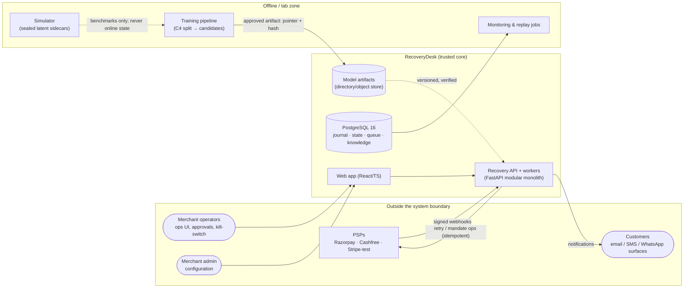
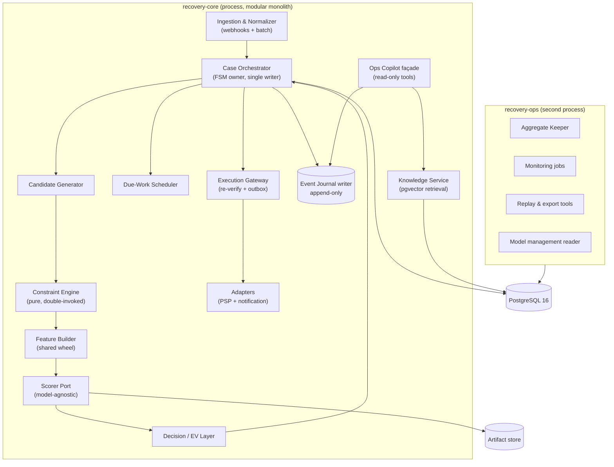
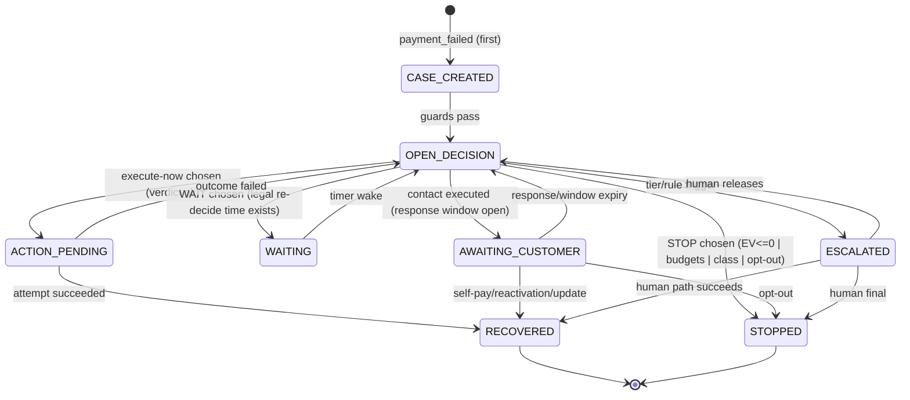
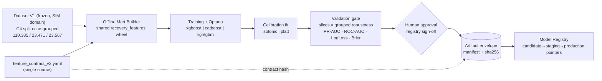
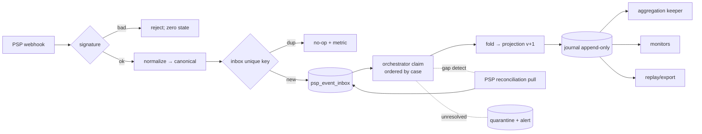
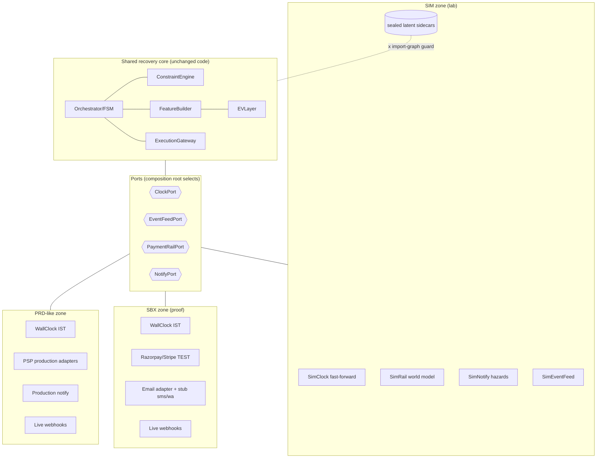
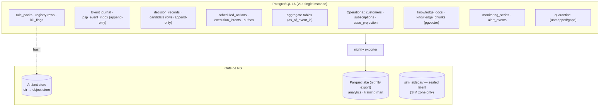

# DEPLOYMENT ARCHITECTURE & IMPLEMENTATION PLAN — FINAL (FIXED)
**AI Revenue Recovery (“RecoveryDesk”) — platform blueprint for implementation**

Version: FINAL 1.1 · Supersedes `DEPLOYMENT_ARCHITECTURE_AND_IMPLEMENTATION_PLAN.md` v1.0 and incorporates the final artifact/RAG/deployment corrections.
Sources of truth: Phase 1 (Problem & Solution), Phase 2 (Data & Intelligence Strategy),
Phase 3A (Simulator Blueprint), Phase 3B (Dataset Implementation), Phase 3C (Model Training),
Dataset V1 (shipped), architecture v1.0 (critiqued, not copied).

**Nature of this document:** architecture design only. No frontend code, no backend code,
no Dockerfiles, no API implementations are produced here. This file is written to be handed
to a separate implementation phase as the build blueprint.

---

## 0. Executive orientation

**The product, in one paragraph.** A failed recurring debit (UPI AutoPay / card SI) enters
as a signed event. The system opens a recovery case inside a deterministic state machine.
A pure, versioned constraint engine says what is lawful. A shared feature package builds
decision-time snapshots with the same code that built the training mart. A replaceable,
calibrated model artifact scores each *legal* candidate intervention. A deterministic
EV/value layer converts probabilities into one bounded choice — execute-now, schedule,
wait, stop, or escalate. Only a guarded execution gateway can touch the outside world, and
it re-verifies constraints immediately before doing so. Every event, decision, and verdict
is journaled append-only, so any action can be replayed and defended months later. Business
monitoring measures ₹ recovered vs baselines; compliance violation count must be exactly
zero. V1 uses one web deployable, one FastAPI backend image with two runtime roles (core and ops),
and one PostgreSQL instance.

**Preserved invariants (prompt §3) are load-bearing:** deterministic recovery state; FSM
owns transitions; ConstraintEngine authors legality; ML never grants permission; EV layer
chooses; only the execution gateway creates side effects; audit/replay; one feature
semantics online/offline; sim/sandbox/prod separation; model-agnostic artifact interface;
fail-closed constraints; explainable decisions.

**Diagram index (all 16, embedded at their sections):**

| # | Diagram | Section |
|---|---|---|
| 1 | System context | §2 |
| 2 | V1 deployment architecture | §23.1 |
| 3 | Logical component architecture | §3 |
| 4 | Frontend/backend architecture | §4 |
| 5 | Runtime recovery flow | §6.3 |
| 6 | ML offline pipeline | §8 |
| 7 | ML online inference | §9 |
| 8 | Constraint + decision flow | §7 / §11 |
| 9 | Case state machine | §6 |
| 10 | Event flow | §12 |
| 11 | Database/storage architecture | §18 |
| 12 | Knowledge/RAG architecture | §16 |
| 13 | Sim ⇄ sandbox ⇄ production boundary | §15 |
| 14 | Model deployment lifecycle | §19 |
| 15 | Failure/recovery flow | §22 |
| 16 | Future-scale architecture (Arch C) | §23.3 |

---

## 1. Independent architecture assessment

### 1.1 Assessment of the v1.0 architecture (kept / changed / fixed)

Read critically against the phase documents rather than reproduced:

**Kept (they were right, and remain right):**
modular monolith V1; journal+projection hybrid; Postgres due-work queue (SKIP LOCKED);
single-writer-per-case; constraint double-evaluation with verdict-hash intents; in-process
scorer behind a strict port; one feature contract + same-wheel sharing; outbox for all
side effects; hierarchical kill switch; sealed sidecars; per-case replay tool;
`merchant_id` from day one.

**Changed / improved in this FINAL:**
- v1.0 had *two* architecture levels; this one defines **three (A/B/C)** with an explicit
  existence matrix (§27) because “production-like demo” and “future scale” are different
  questions with different answers.
- v1.0 was silent on the **web platform**; §4 now defines the frontend architecture
  (React/TypeScript SPA, page model, API boundary, auth boundary, live-ness model) without
  implementing it.
- v1.0 treated knowledge documents as “not model data” and stopped there; this FINAL adds
  a first-class **Knowledge/RAG layer** (§16) and an **Ops Copilot boundary** (§17) with
  the hard rule *retrieved text never overrides machine-readable constraints*.
- v1.0's monitoring was a single table; §20 now structures it into the required four
  categories (technical / model / business / compliance) with **business metrics first-class**,
  since the evaluation bar is ₹-recovered vs baselines.
- v1.0's roadmap was milestone-based; §28 is now phase-based with explicit dependencies,
  sequenced to minimize rework (frontend arrives after stable read APIs, knowledge after a
  stable audit format).
- v1.0 named event types only by example; §12 freezes the full runtime event enum aligned
  with the brief's vocabulary (payment_failed … case_recovered).
- v1.0 deferred “Temporal or not” by trigger; §24 now includes the full technology
  evaluation table (React/TS, FastAPI, Postgres, Docker, Redis, Kafka, Celery, Temporal,
  model server, vector store, object storage, cloud) with “why / what / why-not-simpler /
  when to introduce”.

**Fixed (genuine weaknesses found):**
- v1.0's aggregates owner ran in the ops loop with a lag flag; that tolerated scoring on
  stale history in rare windows. **Fix:** the online feature builder gains a synchronous
  per-case *aggregate catch-up* (fold the case's own journal tail before snapshotting) —
  costing ≤ a few ms — so history features are never behind the case's own events (§10.4).
  Global (cross-customer) priors stay asynchronous by nature and are monitored.
- v1.0's kill-switch blocked execution but scheduler rows kept firing (harmless but noisy
  and confusing in demos). **Fix:** scheduler claims consult kill-scope flags first and
  park rows with a journaled `ACTION_PARKED_KILL_SWITCH` marker (§13).
- v1.0 did not pin a concrete deadline model for PSP reconciliation. **Fix:** fixed SLAs
  per adapter plus a documented last-resort poll fallback (§14.4).

### 1.2 The architectural thesis (independent)

**What is the simplest architecture that still genuinely solves the real problem?**
Two deployables (`web` + `api`+workers-in-one-image in V1), one PostgreSQL, one ML
artifact directory, one optional knowledge index living *inside the same Postgres*
(pgvector). A deterministic FSM owns case truth; a pure constraint engine owns legality
and is invoked at decision *and* execution; a calibrated artifact answers P(success|state,
action) only for legal candidates; deterministic EV arithmetic — with registry constants,
never invented code constants — picks one bounded action; a guarded gateway turns choices
into external effects with at-most-once semantics; an append-only journal plus frozen
decision records make “why?” answerable forever. No broker, no cache tier, no workflow
engine, no microservices in V1.

**Main architectural risks** (top eight, compressed; mitigations inline where owned):
R1 simulator-fit probabilities ≠ world probabilities → artifact carries `training_domain`,
cold start on doctrine + hierarchical priors, calibration-at-maturity monitoring, sandbox
shadow gate. R2 webhook disorder → inbox dedup, per-case ordered fold, gap/reconcile, quarantine.
R3 feature skew → single contract, same wheel, hash checks at three seams, nightly replay.
R4 a learned/language component widening permissions → structurally impossible (§7.3,
§17.3): no import path, no constructor, second check. R5 duplicate money actions →
deterministic intent IDs + outbox + provider idempotency keys. R6 EV constants fictional →
registry-tagged, hash stamped, sensitivity-tested (§11.3). R7 production model frozen-to-
wrong-candidate → family-agnostic envelope + staged rollout (§19). R8 V1 will be tempted to
wear C's costume (Kafka/K8s) before measurements justify it → explicit rejection section §29.

**What should NOT be built (even later, unless evidence changes):** an LLM that chooses
actions; micro-services per module; a feature-store vendor; a separate vector database in
V1/A/B; a multi-agent framework; online RL; a rules DSL; frontend talk to PSPs.

---

## 2. System context and product boundaries (Scope A)

### 2.1 Diagram 1 — System context



### 2.2 Product boundaries (what is inside vs outside)

| Concern | Inside RecoveryDesk | Outside / partner |
|---|---|---|
| Case truth & legal loop | ✅ FSM + constraints + EV + gateway | — |
| PSP integration mechanics | ✅ adapters (test/prod) | PSP dashboards stay authoritative for settlement |
| Money movement semantics | ❌ we request retries/links; we never hold funds | PSP/bank rails |
| Customer messaging content | ✅ template-faithful rendering (LLM optional, gated) | merchant's brand legal sign-off |
| Merchant billing/catalog | ❌ read-only references | merchant billing system |
| Knowledge & doctrine | ✅ reference layer (§16), *advisory* | NPCI/RBI/PSP docs remain the source; **constraints are compiled from them, not the other way around** |
| Model training | ✅ offline pipeline | Kaggle/GPU notebooks may originate candidates; registry is the only door to prod |

<!-- CONTINUE_FINAL -->

---

## 3. Logical component architecture (Scope C)

### 3.1 Diagram 3 — Logical components (one process in V1, clear owners)



### 3.2 Component cards (responsibility · input · output · state · deps · failure · security · sync/async)

All cards follow the required attribute set; deployment processes come in §23.

**C1 Ingestion & Normalizer**
- Resp: receive signed PSP webhooks + merchant batch uploads; authenticate; map dialect →
  canonical events using versioned code maps; persist raw payloads verbatim.
- In: HTTP webhook (headers+body), CSV batch, code-map version. Out: `psp_event_inbox` rows.
- State: none of its own. Deps: secrets, code map, DB. Failure: bad signature → 4xx, zero
  state side effects; unmapped code → `UNMAPPED` event + quarantine alert; duplicate → no-op.
- Security: the only public ingress; signature gate for every downstream mutation. Sync
  (acks 200 fast; processing is downstream-async).

**C2 Case Orchestrator (FSM owner)**
- Resp: drain ordered case events; fold into projection; invoke decision pipeline at
  decision points; journal every mutation; own `case_version`.
- In: inbox rows, projection, verdicts, EV choice, scheduler wakes, human commands.
- Out: events, projection updates, decision records, intents, schedule rows.
- State: `case_projection` (+ FSM transition table as code, not data-owning).
- Deps: C3–C8, journal. Failure: any error → tx rollback, case `needs_attention`, no
  silent re-drive; restart replays durable inbox. Security: the *only* case mutator —
  the authority boundary learning components cannot cross. Async loop (per-case serialized).

**C3 Candidate Generator**
- Resp: expand the *bounded* action space into concrete candidates (action × legal window
  bins × channels), capped by config, for the case's current class/state.
- In: snapshot, calendar module (salary clusters, legal hours), config. Out: candidate list.
- State/deps: config pack only. Failure: empty list is legal (forces STOP/ESCALATE path).
- Security: cannot produce actions outside the frozen vocabulary (Phase 3A §7). Sync.

**C4 Constraint Engine**
- Resp: authoritative legality: budgets, windows, class eligibility, state rules, caps,
  opt-out, kill-switch scopes; per-candidate reasons; verdict hashes. **Pure functions.**
- In: snapshot, candidates, rule pack, injected clock. Out: `Verdict[]`.
- State: none. Deps: rule-pack YAML+code. Failure: exception/unknown ⇒ deny + kill event.
- Security: compliance core; invoked twice (decision + gateway). Sync.

**C5 Feature Builder (shared wheel)**
- Resp: build contract-exact feature rows per (case, candidate); synchronous per-case
  aggregate catch-up; stamp `as_of_event_id` + `contract_hash`; enforce exclusion list.
- In: snapshot, aggregates, candidate, clock. Out: typed feature rows.
- State: none. Deps: `recovery_features` package, contract YAML, aggregates, tail-reader.
- Failure: contract mismatch with loaded artifact → refuse scoring; missing history →
  contract null-policy + `defaulted` flags journaled. Security: online leakage firewall
  (rejects excluded/identifier/post-decision fields). Sync.

**C6 Scorer Port**
- Resp: batch P(success) per legal candidate from the active (and optionally shadow)
  artifact: loading, sha256 verify, family dispatch, calibration application, metadata stamping.
- In: feature rows, artifact manifest. Out: `ScoreBatch` (+versions + domain + mode).
- State: in-memory verified artifact cache only. Deps: artifact store reader.
- Failure: boot verify fail → process refuses to serve; runtime error → doctrine fallback,
  flagged+journaled; never permission-giving. Security: advisory; output cannot reach the
  gateway except via C7+C4; `training_domain=SIM` disclosed per Phase 2 honesty. Sync.

**C7 Decision / EV Layer**
- Resp: convert p̂ → one bounded choice using registry economics; stop/escalate defaults;
  doctrine fallback mode; tie-breaking.
- In: feasible set + verdicts, scores, snapshot, constants bundle. Out: `DecisionRecord`.
- State: none. Deps: registry (costs/fatigue/tiers). Failure: all-negative EV → STOP/ESCALATE;
  never emits anything outside the feasible list (return type is a member of the input set).
- Security: the exact seam where "prediction" vs "business decision" stays separated. Sync.

**C8 Due-Work Scheduler**
- Resp: durable wake-ups (windows, cooldown expiry, awaiting dwell, reconciliation ticks)
  as rows; at-least-once claim (SKIP LOCKED); kill-scope aware parking.
- In/out: `scheduled_actions`. State: that table. Deps: DB, kill flags.
- Failure: lease expiry re-claim; duplicates harmless via case_version; parked rows journal
  `ACTION_PARKED_KILL_SWITCH`. Security: none directly; legality is never trusted to timing. Async.

**C9 Execution Gateway**
- Resp: sole external effect-ful component; re-verify constraints vs current state;
  idempotent dispatch via adapters; outbox; delivery confirmation; interface to money.
- In: intents (with verdict hash), projection, adapters. Out: PSP calls, notifications, events.
- State: intents + outbox ledgers. Deps: C4 re-verify, adapters, idempotency store.
- Failure: hash mismatch/current-state deny → refuse + kill event; adapter fault → backoff
  → terminal fail event → Orchestrator re-decides. Security: the guarded gate; bypass is a
  compile-time error (intent type requires verdict hash). Async worker.

**C10 Adapters (PSP + Notification)**
- Resp: dialect isolation behind ports; auth, rate limits, canonical error mapping; fixtures.
- In: canonical ops + idem keys. Out: canonical results/errors. State: none. 
- Failure: canonical error classes; per-provider circuit breaker; never leak dialect upward.
- Security: credential isolation (env-scoped keys; wrong-env key → startup refusal). Async
  (called by gateway).

**C11 Knowledge Service**
- Resp: curated document ingestion → chunking → pgvector index → grounded retrieval with
  citations; *advisory only* (§16).
- In: documents corpus (regulatory/PSP/runbooks/vendor doctrine/internal), query. Out:
  passages + citations + distance metadata. State: `knowledge_docs/chunks` tables.
- Deps: embedding model (local sentence-transformers default) + pgvector. Failure: index
  unavailable → copilot degrades to citation-free structured answers; execution path untouched.
- Security: cannot mutate; content never authority for constraints. Sync (query-time), offline (ingestion).

**C12 Ops Copilot façade (optional)**
- Resp: answer operator questions from *structured records first*, knowledge second; render
  case explanations; never act (§17).
- In: user query, case id context. Out: grounded answer with citations to decision records
  / events / knowledge chunks. State: conversation logs only (for audit).
- Deps: LLM API (flag), C11, journal readers. Failure: LLM offline → deterministic renderer
  only; still fully functional. Security: read-only tool registry; import-graph CI guard
  proves no path to executor. Sync.

---

## 4. Frontend architecture (Scope B)

Scope decision: define the architecture now; implement later. React + TypeScript SPA
(Vite build), served as static assets behind the same origin as the API in V1; state via
server-state-first model (TanStack Query) + minimal UI store; charts via a light library
(e.g., ECharts). **No PSP calls from the browser ever; browser sees only canonical domain
DTOs.**

### 4.1 Diagram 4 — Frontend/backend architecture

```mermaid
flowchart LR
    subgraph BROWSER["Browser (React/TS SPA)"]
        R[Router] --> PG1["/overview · /cases · /cases/:id\n/timeline · /outcomes · /model\n/knowledge · /admin · /audit"]
        PG1 --> QS[TanStack Query\ncache + polling]
        PG1 --> CMD[Command forms\n(approve/reject · kill-switch)]
        QS --> API1[api-client (typed SDK\ngenerated from OpenAPI)]
        CMD --> API1
    end
    subgraph SRV["Same origin (V1)"]
        STATIC[Static assets]
        FAST["FastAPI\n/api/v1 read models\n+ commands"]
        AUTH["Session/JWT\nrole: operator|reviewer|admin"]
    end
    API1 -->|"GET polling 15–30s (V1)"| FAST
    API1 -->|"POST commands\n(re-auth for destructive)"| FAST
    FAST --> AUTH
    FAST -->|DTOs only — no raw provider payloads| API1
```

### 4.2 Page model (every screen consumes live backend state — no static dummies)

| Route | Purpose | Primary API resources | Live-ness (V1) |
|---|---|---|---|
| `/overview` | Batch economics: ₹ recovered vs B1/B2, open cases, violations | `GET /metrics/overview` | poll 30 s |
| `/cases` | filterable case list (state, class, rail, tier, policy) | `GET /cases?…` | poll 30 s |
| `/cases/:id` | case detail: projection + counters + next legal options | `GET /cases/:id` | poll 15 s |
| `/cases/:id/timeline` | event journal + decision records rendered side-by-side ("why") | `GET /cases/:id/timeline` | poll 15 s (+ SSE optional later) |
| `/outcomes` | cohort/policy outcomes, costs, time-to-recover | `GET /outcomes/…` | poll 60 s |
| `/model` | artifact info, versions, shadow/canary status, calibration report | `GET /model/status` | poll 60 s |
| `/knowledge` | curated corpus browser + citations | `GET /knowledge/search` | on demand |
| `/copilot` (flagged) | Ops Copilot chat against records+knowledge | `POST /copilot/query` | on demand |
| `/admin` | rule packs, constants, scenario config, kill switch, PSP keys state | `GET/POST /admin/…` | re-auth for destructive |
| `/audit` | compliance counts, replay invocations, kill/resume history | `GET /audit/…` | poll 60 s |

### 4.3 Frontend/backend contract rules
1. Backend publishes an **OpenAPI 3** doc; the frontend SDK is generated — DTO drift is a
   build failure, not a runtime bug.
2. Read DTOs are *shaped for screens* (already-aggregated); the frontend never recreates
   domain logic (no recomputing legality client-side; it renders verdicts).
3. Commands are explicit, small, and audited: `approve_escalation`, `reject_escalation`,
   `pause_scope(scope)`, `resume_scope(scope, reason)`, `force_stop_case(reason)`.
   Destructive ones demand re-auth and journal a `HUMAN_DECISION` event.
4. **No realtime dependency in V1**: polling at the cadences above is sufficient at demo
   scale; SSE channel `/api/v1/stream/cases/:id` is reserved for Architecture B (single
   dependency: when the timeline poll rate bothers operators).
5. The UI renders probabilities as *predictions* and decisions as *EV choices* — the
   prediction-vs-decision distinction (§11) is visible in copy, not just code.

---

## 5. Backend application architecture (Scope C)

FastAPI modular monolith. **One image → two roles** (`core`, `ops`) chosen by env flag.
Routers map 1:1 to read models + commands; domain services under them; no router may
import adapter or LLM packages (CI boundary tests).

Logical module layout (names chosen independently; not bound to Phase-3B module names):

| Module | Owns | Notes |
|---|---|---|
| `ingest` | webhook endpoints, batch upload, signature verify, code-map lookup | thin; writes inbox only |
| `cases` | case read models, list/detail/timeline queries | read-only queries over DB views |
| `orchestrate` | FSM, fold, decision loop, single-writer protocol | the heart |
| `constraints` | pure engine + pack loader | no I/O; the authority |
| `features` | shared wheel (this repo is the *consumer*; source of truth versioned with training) | hash-checked |
| `scoring` | artifact loader, scorer port, fallback | advisory only |
| `decide` | EV layer, candidate generation, policy packs | deterministic |
| `schedule` | due-work rows, claiming, parking | SKIP LOCKED |
| `execute` | gateway, intents, outbox, re-verify | guarded side effects |
| `adapters` | PSP + notify ports | dialect quarantine |
| `journal` | append-only writer, retention hooks | no update/delete paths |
| `audit` | decision records, replay service, trace renderer | months-later answers |
| `monitor` | metrics ingestion + alert events (consumers in ops role) | four categories §20 |
| `knowledge` | ingestion pipeline + retrieval | advisory |
| `copilot` | tool registry + façade (flag) | read-only |
| `admin` | rule packs, constants, keys-state, kill switch | re-auth + journal |
| `authn/z` | sessions/JWT, roles, scope checks | small for V1 |

**Sync/async boundary (explicit):** synchronous — ingestion ack, read APIs, command
accepts, decision pipeline inside a case wake. Asynchronous — case event processing,
scheduled wakes, gateway dispatch, outbox delivery, monitors, exports, knowledge ingestion.


## 6. Recovery case state machine (Scope D)

### 6.1 Diagram 9 — Final runtime state machine



### 6.2 Transition rules (deterministic, journaled)
- **`OPEN_DECISION → ACTION_PENDING`** requires: constraint verdict allowed (hash recorded),
  candidate exec time inside a legal window *at execution*, budgets available.
- **`OPEN_DECISION → AWAITING_CUSTOMER`** requires contact eligibility; wake scheduled at
  `exec_ts + response_window_hours` atomically with the transition.
- **Terminal states `RECOVERED` / `STOPPED` are absorbing**: any post-terminal inbound event
  journals as `POST_TERMINAL_OBSERVED` — evidence, never a state effect.
- **Counters as guards:** `retries_used ≤ 3` (NPCI 1+3 — FACT), `contacts ≤ 2` per case,
  contact cooldown ≥ 20 h, quiet-hours honored at execution time, opt-out blocks contact.
- **Freeze semantics:** `ESCALATED` suspends auto-actions until `HUMAN_DECISION`; kill-switch
  scopes freeze timer effects (parked scheduler rows, journaled).
- **Ownership & concurrency:** exactly one writer (Orchestrator); transitions occur in one
  DB transaction with journal append + projection version bump; optimistic concurrency via
  `expected_version`; near-simultaneous events serialize on the case row lock.
- Why `WAITING` was split from v1.0's informal “wait”: with payment windows and cooldowns,
  *scheduled re-decision is a first-class state* — it makes timer ownership explicit and
  keeps the FSM honest under restarts.

### 6.3 Diagram 5 — Runtime recovery flow (the end-to-end answer)

```mermaid
sequenceDiagram
    autonumber
    participant PSP
    participant IN as Ingestion
    participant ORC as Orchestrator+FSM
    participant CE as ConstraintEngine
    participant FB as FeatureBuilder
    participant SC as Scorer
    participant EV as EVLayer
    participant GW as Gateway
    participant DB as PostgreSQL
    PSP->>IN: payment_failed (signed)
    IN->>DB: insert inbox (dedup key) → 200 ack
    DB-->>ORC: claim case (row lock, ordered)
    ORC->>DB: journal PAYMENT_FAILED; projection v+1; open/continue case
    ORC->>CE: feasible verdicts (candidates × snapshot)
    CE-->>ORC: allow/deny + reasons + rule_pack_hash
    ORC->>FB: features per legal candidate (sync catch-up first)
    FB-->>ORC: rows + contract_hash + as_of proof
    ORC->>SC: score(batch)
    SC-->>ORC: p̂ + model/calibration versions + training_domain
    ORC->>EV: EV rank; tier/escalation policy; thresholds
    EV-->>ORC: chosen action | WAIT | STOP | ESCALATE
    ORC->>DB: journal DECISION_MADE (record = §19 atom)
    alt scheduled legal window
      ORC->>DB: due-work row (due_at)
    else execute now
      ORC->>GW: intent(verdict_hash, idem_key)
      GW->>CE: re-verify vs CURRENT projection
      alt still legal
        GW->>PSP: adapter call (idempotent)
        PSP-->>GW: attempt ref
        GW->>DB: journal INTERVENTION_EXECUTED
      else denied
        GW->>DB: journal INTERVENTION_BLOCKED + kill event
      end
    end
    PSP->>IN: outcome webhook → loop → RECOVERED | STOPPED (absorbing)
    DB->>DB: monitors: ₹ recovered; compliance violations must equal 0
```

---

## 7. Constraint architecture (Scope E)

### 7.1 Authority scope (what the engine owns)
Ownership matrix (all versioned, all registry-tagged):

| Rule family | Examples | Tag | Pack location |
|---|---|---|---|
| Budgets | original + max 3 retries/cycle; ≤2 contacts/case; cooldown ≥20 h | FACT / DECISION | `rule_packs/{rail}_vN.yaml` |
| Windows | legal exec hours per rail; contact hours; quiet-hours→snap | FACT-referenced / ASSUMED values | packs + `calendar` module |
| Class eligibility | hard classes (CARD_LOST_STOLEN, CARD_EXPIRED, MANDATE_CLOSED/PAUSED) → no auto retry; PM-update/link only; `UNMAPPED` → non-retryable | FACT doctrine | packs |
| State rules | terminal absorbing; AWAITING blocks retries; ESCALATED freezes; opt-out blocks contact | FACT/DECISION | FSM guards + packs |
| Amount/AFA | ₹15K cap; AFA-required class → notify path only | FACT | packs |
| Stop/escalate | budget exhaustion, mandate_dead, window expiry, tier triggers | DECISION | packs + costs |
| Kill-switch | global/merchant/rail/pack/case scopes | SYS | admin API + flags table |

Every verdict carries `{candidate_id, allowed, reasons[], rule_ids[], rule_pack_hash,
evaluated_at}` so a deny is explainable to a human without reading code.

### 7.2 Diagram 8 — constraint + decision flow

```mermaid
flowchart TD
    SNAP[Case snapshot] --> CG[Candidate Generator<br/>bounded vocabulary]
    CG --> CE1{{Constraint Engine<br/>decision-time eval}}
    CE1 --> FEAS[Feasible set + verdicts + pack hash]
    FEAS --> FB[Feature Builder] --> SC[Scorer p̂] --> EV[EV Layer<br/>registry constants]
    EV --> CH[DECISION_MADE journal<br/>chosen|stop|wait|escalate]
    CH --> INT{{Execution Intent<br/>verdict_hash required by type}}
    INT --> CE2{{Constraint Engine<br/>re-verify vs CURRENT state}}
    CE2 -- ok --> GW[Gateway dispatch → outbox]
    CE2 -- deny --> BLOCK[INTERVENTION_BLOCKED + kill event]
```

### 7.3 Structural bypass-resistance
- `ExecutionIntent` is unconstructable without `verdict_hash`; the gateway recomputes
  against **current** projection; mismatch → refuse forever + kill-switch event. Verdict
  staleness (case moved on) is a deny, not a retry.
- Scorer/Knowledge/Copilot/Frontend have **no dispatch path** to the gateway (package
  isolation + CI import-graph tests); frontend receives feasible options pre-computed —
  it renders law, it does not write law.
- Operator commands (`force_stop`, `approve_escalation`…) also flow *through* C4 — a
  human can close a case, but cannot mint an illegal action either.
- Kill-scopes consulted at scheduler claim AND gateway dispatch, not just decision time.
- Rule evaluation is pure (no I/O/RNG): property-based tests fuzz (state × candidate ×
  pack) trios; mutation tests target every rule line — a bypass in engine logic fails CI.

---

## 8. ML training architecture (Scope F) — offline pipeline

### 8.1 Diagram 6 — offline pipeline



Rules:
1. Mart rows are produced **only** by the shared wheel — notebook-side feature code is
   forbidden as a production input (one-math rule).
2. Split grouped by `case_id` (no case leaks across partitions — Phase 3C C4).
3. TEST touched once post-selection; validation drives Optuna; grouped-by-customer
   robustness is a gate, not a footnote (Phase 3C §15).
4. Every candidate ships slices (rail × failure_class × calendar bucket) + calibration
   report — calibration is the primary gate because EV consumes probabilities (Phase 2 §6).
5. Registry entry requires: manifest, metrics on untouched TEST, dataset fingerprint,
   contract hash, approver identity, risk tier. Pending ensemble results (Phase 3C §23)
   enter exactly here — as envelope `family=blend` — with zero runtime changes.

---

## 9. ML inference architecture (Scope G) — online pipeline


### 9.0 Current V1 model artifact status

The current confirmed production candidate from Phase 3C is the **native-categorical
XGBoost model** produced by `05_xgboost_native_categorical_kaggle_gpu.ipynb`.

The verified artifact bundle currently consists of:

```text
models/c5/xgboost_native_categorical_c5.json
reports/c5_xgb_native_categorical/native_categorical_schema.joblib
reports/c5_xgb_native_categorical/best_params.json
reports/c5_xgb_native_categorical/native_categorical_metrics.csv
reports/c5_xgb_native_categorical/optuna_trials.csv
```

The first two are the runtime-critical inference artifacts:

- `xgboost_native_categorical_c5.json` — trained native-categorical XGBoost model.
- `native_categorical_schema.joblib` — feature order, categorical columns, and category vocabulary.

The remaining files are model-selection/evaluation metadata.

**Important calibration distinction:** the current native-XGBoost Kaggle artifact bundle does **not**
contain a separately saved calibration artifact. Therefore the architecture supports calibration,
but the implementation MUST treat calibration as a separately versioned optional artifact until
a calibration file is actually produced and verified.

For the current artifact:

```text
model family: xgboost_native_categorical
feature count: 43
categorical features: 17
numeric features: 26
training domain: SIM
```

Promotion to a calibrated production scorer requires:

```text
model artifact
+
native categorical schema
+
separately versioned calibration artifact (when calibration is enabled)
+
artifact manifest
+
sha256
+
matching feature-contract hash
```

If no calibration artifact is present, the scorer must record:

```text
calibration_version = null
mode = uncalibrated
```

rather than pretending calibration exists.

### 9.1 Diagram 7 — online inference

```mermaid
flowchart LR
    SNAP[Case snapshot @ decision] --> CF{Per-case aggregate<br/>sync catch-up}
    CF --> FB[Feature Builder<br/>shared wheel]
    CONTRACT["feature_contract_v3 (boot-pinned)"] --> FB
    FB --> V[Contract validation<br/>dtypes · vocab · nulls · exclusions]
    V --> SC[ScorerPort.score-batch]
    ART[(Artifact envelope<br/>family | blend<br/>calibration vK<br/>training_domain<br/>contract_hash)]
    ART -->|sha256 + hash match| SC
    SC --> P[calibrated p̂ per candidate + metadata]
    SC -. on error .-> FBK[Doctrine fallback scorer<br/>flagged + journaled]
    P --> EVC[EV Layer §11]
    FBK --> EVC
```

- **Batch-per-decision:** all legal candidates scored in one call; deterministic candidate
  ordering (sorted) so replays are byte-stable.
- **Metadata discipline:** every ScoreBatch carries `(model_id, model_version,
  calibration_version, training_domain, contract_hash, mode∈{active|shadow|fallback})` —
  journaled into the decision record.
- **Latency budget (V1):** sync catch-up ≤ 20 ms typical; feature build ≤ 30 ms; scoring
  ≤ 25 ms for ≤ 12 candidates; total decision p95 < 300 ms wall (incl. DB), measured by
  the soak test in Phase D (§28).
- **Fallback semantics:** doctrine scoring mirrors B2 (Phase 2 §14) through the same EV
  layer with `mode=fallback` — it can *lose* but cannot *break law*.

---

## 10. Feature/data architecture & train/serve consistency (Scope H)

### 10.1 One contract file, three consumers
`configs/registry/feature_contract_v3.yaml` — consumed by offline MartBuilder, online
Feature Builder, Artifact Loader. Per feature: `name, dtype, null_policy, vocab (frozen
categoricals), derivation_id, availability_rule`. Plus row-level proof rule
(`feature_as_of_event_id < decision_event_id`) and the **exclusion list** (identifiers,
policy metadata, post-decision/leakage fields — Phase 3C §5). Base family: the Phase 3C §4
thirty-three (amount/tenure/history/counters/timing incl. `salary_day_proxy_dom` — the
noisy merchant-side proxy, never the latent day — rail/bank/segment/plan/value_tier,
failure classes, `instrument_fixed`, demographics, calendar, `action_type`, `channel`,
`amount_inr_log1p`) + engineered set (`retry_intensity`, `contact_intensity`,
`salary_distance_abs`, ratio & interaction terms) **only when** the selected artifact's
manifest registers them (contract minor-version bump).


### 10.1a Current native-XGBoost schema binding

For the current native-categorical XGBoost artifact, the deployment loader must validate the
saved schema before serving:

```text
runtime feature names/order
        ==
saved `features`

runtime categorical columns
        ==
saved `categorical_features`

runtime category vocabulary
        ==
saved `category_vocab`

runtime feature count
        ==
43

runtime categorical count
        ==
17

runtime numeric count
        ==
26
```

The `native_categorical_schema.joblib` file is therefore part of the model's runtime compatibility
contract. A matching global `feature_contract_hash` is necessary but not sufficient: the exact
artifact schema must also match. Any mismatch blocks model activation.

### 10.2 Hash enforcement at three seams + nightly replay
1. Training: mart files embed `contract_hash`; artifact manifest records it.
2. Serving: loader refuses artifacts whose hash ≠ process contract hash.
3. Journal: every decision stamps both hashes + `as_of_event_id`.
4. Nightly: recompute N historical decision rows from journal data; byte-compare (documented
   float tolerance) vs journaled rows; divergence ⇒ promotion block + incident ticket.

### 10.3 Same wheel, two views
`features.build(snapshot, aggregates_view, candidate, contract)` is called by both
builders. Only the *aggregate source* differs (mart columns vs live tables); math cannot
diverge. The nightly replay is the empirical proof this property holds.

### 10.4 Availability & staleness
Per-case history is **synchronously current** (catch-up fold in §9.1); cross-customer
priors are batch-refreshed with lag monitoring (`aggregate_max_lag_min`); defaulted
features are individually flagged so slice-reports can correlate quality with defaults.


## 11. Decision / EV architecture (Scope I)

### 11.1 The one formula (and where every constant lives)
```
EV(a | snapshot) =  p̂_a · recoverable_value(a, snapshot)
                  − cost_action(a)                    # ₹ per action type
                  − cost_channel(a.channel)           # ₹ per channel
                  − fatigue_cost(a, snapshot)         # registry curve over contacts
                  − attempt_opportunity_cost(a)       # uses scarce retries
choice = argmax over feasible candidates (stable tie-break: earliest legal window)
if max EV ≤ stop_threshold(value_tier):  → STOP  (or ESCALATE if tier policy says)
if escalation policy triggers:           → ESCALATE (auto-actions freeze)
```
`recoverable_value` = `amount_at_risk × margin_factor(merchant config)` — no invented
multipliers; all constants resolve from `configs/costs.yaml` + registry entries tagged
{FACT, ASSUMED, DECISION} with scenario multipliers (pessimistic/base/optimistic/
adversarial, per Phase 3B). Every decision stamps `constants_hash`. A constant not
present in the registry fails the config-lint contract test — **hard-coded policy numbers
are a build error** (§29).

### 11.2 Prediction vs decision — the preserved distinction
`p̂` is an *estimate of success under the observed policy history* (associational, per
Phase 3C §21 — not causal uplift). The EV layer is the only place probability becomes a
business choice. The UI renders both side by side; the journal keeps both; the claim
template (Phase 2 §15) forbids causal wording in reports.

### 11.3 Constant governance
- Ownership: ops-editable only through Admin API → versioned registry rows (never hot-set).
- Sensitivity: pessimistic/optimistic multipliers pre-registered; E1 harness re-runs policy
  value under multipliers before any constant change promotes.
- Doctrine fallback mirrors Phase 2 B2 exactly so “does the spreadsheet beat the ML?”
  remains answerable continuously (same EV path, `policy_id=doctrine-b2`).

---

## 12. Event & audit architecture (Scope J)

### 12.1 Runtime event enum (frozen v1) and producers

| event_type | Producer | Consumer(s) | Notes |
|---|---|---|---|
| `payment_failed` | adapters/ingestion | orchestrator | case trigger or retry outcome |
| `payment_succeeded` | adapters/ingestion | orchestrator, outcomes job | closes to RECOVERED |
| `recovery_case_opened` | orchestrator | UI, monitors | once per case |
| `decision_required` | orchestrator/scheduler | orchestrator | wake semantics |
| `candidates_generated` | orchestrator | audit | candidate ids + windows |
| `intervention_proposed` | decision layer | audit, UI | with EV vector |
| `intervention_blocked` | gateway | audit, kill-switch monitor | verdict-hash/state denies |
| `decision_made` | orchestrator | audit, replay | the atom (§19) |
| `retry_scheduled` | orchestrator | scheduler | due-work row pointer |
| `intervention_executed` | gateway | orchestrator, monitors | attempt ref |
| `notification_sent` | gateway | orchestrator | channel+template+locale |
| `customer_responded` | ingestion/gateway | orchestrator | self_pay/reactivated/updated/opt_out/none |
| `mandate_state_changed` | adapters | orchestrator, features | pause/revoke truth |
| `case_escalated` | orchestrator | ops UI, monitors | queue entry |
| `human_decision` | admin/ops API | orchestrator | approve/reject/release/resume |
| `case_stopped` | orchestrator | monitors, UI | with reason |
| `case_recovered` | orchestrator | monitors, outcomes | absorbing |
| `post_terminal_observed` | orchestrator | audit | boundary discipline evidence |
| `kill_switch_fired` / `resumed` | admin API/auto | everything | scope+owner journaled |

**Contract (all events):** `{event_id: uuidv7, case_id, case_seq, merchant_id,
occurred_at, recorded_at, actor, event_type, payload_json, rule_pack_hash?, policy_id?,
model_version?, feature_contract_hash?, idempotency_key?, correlation_id, env: sim|sbx|prd}`.
Ownership: only the producer module may append its types (enforced by writer API, not by
discipline). Ordering: total per-case via `case_seq` assigned under the case lock;
`recorded_at` monotonic per writer. Correlation: `correlation_id` ties webhook → decision →
intent → adapter call → outcome. Replay: full fold reproducibility is a property test.

### 12.2 Diagram 10 — Event flow



Storage decision (V1): **append-only Postgres journal + SKIP-LOCKED queue tables** — no
Redis, no broker. Justification keyed to requirements: peak demo/sandbox traffic ≪ 50
events/s; PG gives transactional co-location of journal+projection (one tx = atomic truth);
exports to the lake make analytics columnar later without touching runtime. Measured
triggers to revisit: webhook ingest p95 > 300 ms, journal > 10⁸ rows, claim collision rate
> threshold — each maps to a specific Arch-C move (§23.3).

---

## 13. Scheduler architecture (Scope K)

- **Representation:** `scheduled_actions(id, case_id, kind, due_at, payload_ref, state,
  lease_owner, lease_until, attempt_count)`.
- **Claiming:** workers `SELECT … FOR UPDATE SKIP LOCKED WHERE state='due' AND
  due_at≤now ORDER BY due_at LIMIT n` with 60 s leases; success path completes in the same
  tx as the orchestrated work; crash ⇒ lease expiry ⇒ re-claim (at-least-once).
- **Kill-scope awareness:** claims check scope flags first; matching rows park
  (state=`parked`) and journal `ACTION_PARKED_KILL_SWITCH`; resume re-queues by SLA.
- **Idempotence:** handlers re-fold via `expected_version`; duplicate delivery folds to
  no-op. Timezone: all `due_at` in UTC; legality computed in IST at execution (never
  trusted from schedule time).
- **Kinds:** `RETRY_WINDOW_OPEN`, `CONTACT_COOLDOWN_END`, `AWAITING_WINDOW_EXPIRY`,
  `ESCALATION_SLA`, `RECONCILE_TICK`, `MONITOR_TICK`.
- **Why not Celery/Redis/Temporal in V1:** measured V1 load ≤ ~10⁴ wakes/hour; SKIP
  LOCKED sustains orders more; adds exactly one new operational concept (leases) instead
  of a new datastore; Arch-C migration is guided by identical semantics (§23.3, §29 table).

---

## 14. Payment / PSP adapter architecture (Scope L)

### 14.1 Ports
```python
class PaymentRailPort(Protocol):      # implemented per provider; core imports ONLY this
    def charge_retry(mandate_ref, amount_inr, idem_key, window_code) -> AttemptHandle
    def fetch_attempt(handle) -> AttemptStatus                        # canonical
    def fetch_events(since: Token, case_refs) -> list[ProviderEvent]  # reconcile
    def mandate_status(mandate_ref) -> MandateStatus

class NotificationPort(Protocol):
    def send(channel, template_id, locale, slots, idem_key) -> DeliveryHandle
    def fetch_status(handle) -> DeliveryStatus
```
Canonical vocab only (failure classes from Phase 3A §6; canonical error classes
{technical, business, rate_limit, auth, unavailable}); dialect lives below the port.

### 14.2 Adapter inventory (V1)
| Adapter | Mode | Purpose | Status |
|---|---|---|---|
| `SimRailAdapter` | offline | deterministic rail for CI + demo-without-network | required |
| `RazorpayTestAdapter` | sandbox | actuation proof on UPI-ish subscriptions | required |
| `StripeTestAdapter` | sandbox | card SI + test-clock scenarios | required |
| `CashfreeAdapter` | sandbox-ready | second Indian PSP | flagged; activation = config |
| Notify adapters | email real / sms|whatsapp stubs | messaging proof without telco cost | required |

### 14.3 Webhook handling & mapping
Per provider: signature scheme, idempotency of callbacks, retry storm behavior absorbed
at adapter; code-map lookup via `psp_code_map_{provider}_vN.yaml`; map version stamped on
every resulting event (so “what did we believe this code meant then?” is answerable).

### 14.4 Reconciliation & SLAs
Gap detector every 5 min: expects outcome ≤ configured SLA after `intervention_executed`
(resolution SLA defaults: card 15 min, UPI 30 min; config-owned); breach → `fetch_attempt`
by idem key; unresolved after 3 pulls (escalating backoff) → quarantine + human alert;
last-resort **scheduled polling fallback** per case batch each hour while any in-flight
intent ages > 2×SLA. Adapter circuit breaker: ≥5 consecutive `technical`/`unavailable`
errors ⇒ pause that provider's dispatch 10 min (journaled; auto-half-open probe).

### 14.5 Credentials
Env-scoped keys (`RAZORPAY_KEY_TEST` vs `…_LIVE`); runtime asserts env/key-prefix pairing
at boot; secrets via mounted files or env — never YAML, never repo (CI secret scan).


## 15. Simulator / sandbox / production (Scope M)

### 15.1 Diagram 13 — the three-world boundary



Boundary laws (testable):
1. Core imports **only** ports; adapter/zone choice is a composition-root config.
2. `sim_sidecar/` is unreachable: CI import-graph test (Phase 3B pattern) fails the build
   on any path; latent truth never has a route to features (contract's exclusion list
   double-enforces).
3. Counterfactual data exists only in SIM; SBX/PRD never contain such columns at all.
4. Env label rides on every event/artifact (`env: sim|sbx|prd`) — marketing-mixing
   simulated and real evidence is then *mechanically* impossible in monitors and claims.
5. One codebase, one build: SIM for datasets/benchmarks, SBX for actuation proof, PRD-like
   via adapter+key swap. Environment = config, not a branch.

---

## 16. Knowledge / retrieval / RAG architecture (Scope N)

Some corpora were deliberately excluded from model training (regulatory PDFs, PSP docs,
vendor doctrine, internal runbooks, model cards). They are **reference knowledge**, and
they stay advisory — by design and by mechanics.

### 16.1 Diagram 12 — Knowledge pipeline

```mermaid
flowchart LR
    DOC["Curated docs
(NPCI/RBI refs · PSP docs · vendor doctrine
internal policies · runbooks · model cards)"] --> ING[Ingestion job
parse → clean → front-matter]
    ING --> CHK[Chunker
heading-aware, 400–800 tok, overlap 15%]
    CHK --> EMB[Embedding model
(local sentence-transformers default)]
    EMB --> IDX[("PostgreSQL pgvector
knowledge_docs · knowledge_chunks")]
    Q[Operator question] --> RET[Retriever
vector ∪ BM25 (tsvector)]
    RET --> RR[Optional reranker (flagged)]
    RR --> ANS[Grounded answer builder
passages + citations + confidence]
    ANS --> UIQ[Ops UI / Copilot façade]
    IDX --> RET
```

### 16.2 Contracts
- **Doc metadata:** `{source, source_url, doc_type: regulation|psp_doc|runbook|vendor_doctrine|model_card, effective_date, retrieved_at, content_hash, authority: reference|regulation_cited}`. Vendor doctrine is tagged exactly that — never laundered into fact (Phase doctrine).
- **Grounding rule:** documentation/policy-shaped answers must cite chunk IDs. If the knowledge
  index is unavailable or the required source cannot be retrieved, do not invent an answer;
  return a deterministic pointer to the compiled rule pack or abstain. Structured answers derived
  from recorded case/decision/rule records may still be rendered without document citations.
- **Authority law (the one that matters):** retrieved text **never** overrides the compiled
  constraint packs. The packs *are* the authority; docs explain them. On conflict, the UI
  shows: “pack `upi_autopay_v3.yaml` rules govern; see registry entry X; document quote is
  reference-only.” No path from a passage to an executable effect exists (§17.3).
- **V1 sizing:** corpus ~O(10²) docs ⇒ O(10⁴) chunks; pgvector (IVFFlat) over a warm table
  is trivially sufficient; a dedicated vector database is **rejected for V1/B** with a
  measured introduction trigger (corpus > ~10⁶ chunks *or* index build time > maintenance
  window *or* p95 retrieval > 300 ms) — §24 row 8.

---

## 17. Agent / Ops Copilot boundary (Scope O)

### 17.1 What “agentic” means here (honestly)
The recovery loop itself is agentic in the meaningful sense: it perceives events over
days, maintains state, chooses among bounded actions, acts on external rails, observes,
and stops/escalates — implemented as deterministic software. **No LLM sits in that loop.**

### 17.2 The optional Ops Copilot (flag-gated)
Read-tools only, each a *deterministic function* the LLM may call:
`get_case(case_id)`, `get_timeline(case_id)`, `get_decision_record(decision_id)`,
`explain_verdict(decision_id, candidate)`, `search_knowledge(query, top_k)`,
`get_model_status()`, `get_outcome_report(batch)`.
Answer modes: (1) **computed** — “why was this blocked?” is answered from the decision
record/verdict structurally (LLM renders, never guesses); (2) **retrieved** — knowledge
answers with citations; (3) **abstain** — no evidence ⇒ say so.

### 17.3 Hard prohibitions (enforced, not requested)
Copilot cannot: authorize/execute actions; modify constraints/config; mutate case state;
call PSPs; bypass policy; invent actions. Enforcement: package isolation (`copilot/`
imports only read DTOs; CI import-graph test), tool registry with read-only types, no
session write grants beyond conversation log. Full product functionality survives with the
LLM dependency unplugged (acceptance test in Phase I: `COPILOT_ENABLED=false` full pass).

---

## 18. Database / storage architecture (Scope P)

### 18.1 Diagram 11 — storage zones (one PostgreSQL in V1)



### 18.2 Responsibilities per store
Operational (OLTP, Orchestrator-writes-only for case rows); journal/inbox (append-only via
DB grants — app role gets INSERT/SELECT, no UPDATE/DELETE); decisions (same grants);
work queue (claim protocol §13); aggregates (keeper-owned); config (Admin API-writes,
versioned rows); knowledge (ingestion-writes); monitoring (jobs-write); quarantine
(operator-visible). Artifacts outside PG (filesystem/object store) but *referenced* by
registry rows with sha256. Exports to the lake keep analytics/training columnar without a
second V1 database. **Deliberately not:** separate DBs per module, Redis, graph stores.


## 19. Decision explanation & auditability (embedded in §12/J — the Decision Record)

**Decision Record atom (frozen, append-only):**
```json
{
  "decision_id": "uuidv7", "case_id": "sbx:01J…", "taken_at": "2026-…",
  "env": "sbx", "state_before": {"fsm": "OPEN_DECISION", "retries_used": 1, "…" : "…"},
  "trigger": {"kind": "event", "ref": "ATTEMPT_FAILED#case_seq=7"},
  "rule_pack": {"id": "upi_autopay", "version": 3, "hash": "…"},
  "constants_hash": "…", "feature_contract_hash": "…",
  "model": {"id": "m1", "family": "xgboost", "version": "4.3.0",
            "calibration_version": 3, "training_domain": "SIM", "mode": "active"},
  "candidates": [
    {"candidate_id": "RETRY@w3", "verdict": {"allowed": true, "reasons": [], "hash": "…"},
     "features": {"…": "contract_v3 row"}, "p_hat": 0.412, "ev_inr": 312.7},
    {"candidate_id": "SEND_REMINDER@sms", "verdict": {"allowed": false,
     "reasons": ["quiet_hours(21:00-08:00)"], "hash": "…"}}
  ],
  "chosen": {"candidate_id": "RETRY@w3", "reason_code": "MAX_EV"},
  "policy_id": "ml-ev-v2", "fallback": false
}
```
Replay: `rd replay --case <id>` rebuilds snapshots from the journal, re-runs the pinned
artifact + packs, and compares each decision (PASS/FAIL per decision). “Why this action?”
months later = read the atom; no model guessing, no log spelunking.

---

## 19b. Model registry & artifact lifecycle (Scope Q)

### Diagram 14 — deployment lifecycle

```mermaid
flowchart LR
    A[Candidate artifact
+ manifest + sha256] --> G{Validation gate
TEST metrics · slices ·
calibration status · grouped robustness}
    G -- fail --> X[rejected; notes recorded]
    G -- pass --> SGN[Human sign-off
registry row: approver · risk_tier]
    SGN --> REG[(Registry pointers)]
    REG --> SH[SHADOW: score+journal only]
    SH --> CN[CANARY: hash(case)%100 < pct]
    CN --> AC[ACTIVE]
    AC -. auto triggers .-> RB[ROLLBACK: pointer flip + journal event]
    MON4[Calibration-at-maturity · drift · fallback rate] -.-> RB
```

### 19b.1 Current artifact promotion gate

Before the current native-XGBoost artifact can become the active production scorer, the registry
must verify all of the following:

```text
✓ xgboost_native_categorical_c5.json is loadable
✓ native_categorical_schema.joblib is loadable
✓ feature count = 43
✓ categorical count = 17
✓ numeric count = 26
✓ runtime feature schema matches saved schema
✓ model feature-contract hash matches process contract
✓ training domain is explicitly recorded as SIM
✓ native categorical support is enabled/verified
✓ evaluation report is attached
✓ calibration artifact is present if `calibration_version != null`
✓ sha256 manifest matches the actual files
```

A missing calibration artifact is **not** a hidden failure: it means the candidate is explicitly
marked `uncalibrated` and may only enter a production stage if the configured V1 policy permits
uncalibrated probabilities. If calibrated probabilities are required by policy, promotion stops
until the calibration artifact is produced and verified.

Canary/shadow are config-scoped (`model_rollout` table), auditable through journal
(`model.mode` stamps), and reversible in one transaction. Rollback target is always the
previous production pointer; rollback emits an event the monitors count.

---

## 20. Monitoring & observability (Scope R) — four categories, business first

| Category | Signals (owner) | Cadence | Threshold behavior |
|---|---|---|---|
| **Business** | ₹ recovered/day vs B1/B2 baselines; recovery rate per cohort; time-to-recover; cost per recovered ₹; contacts/case; escalation share; stop reasons mix (outcomes job) | daily report | deltas outside baseline bands → investigation; **claim template only** (Phase 2 §15) |
| **Model** | score PSI; calibration-at-maturity (per rail × class); feature PSI/TVD; fallback usage; contract-hash mismatches (must be 0) | daily/weekly | drift > bands ⇒ shadow/rollback suggestion; mismatch = 0-tolerance incident |
| **Compliance** | constraint violation count (**target exactly 0**); blocked intents; kill-switch fires/resumes; quiet-window breaches; post-terminal mutations (must be 0) | 15 min | any violation ⇒ auto kill-scope + page; immutable report persisted |
| **Technical** | webhook lag/dup/gap rates; queue lag; adapter breaker states; outbox failures; decision p95; DB bloat | 15 min | incident runbooks; scale triggers feed §23.3 |

Everything is journaled and exported; V1 renders into the `/audit` and `/overview` pages —
no external APM needed.

---

## 21. Security & compliance (Scope S)

- **AuthN/Z:** V1: signed sessions + JWT, roles {operator, reviewer, admin}; destructive
  commands require re-auth; service-to-offline zone is artifact-push only (no callback).
- **Secrets:** env/mounted files; env-name↔key-prefix pairing asserted at boot; CI secret
  scan; rotation supported by two-slot signature verification.
- **Tenancy:** `merchant_id` first-class everywhere (V1 seeds one merchant) ⇒ B-level
  tenancy is policy, not migration.
- **PII minimization:** tokenized contact refs; no card/VPA data at rest; notification
  payloads = template ids + slots; addresses fetched/handled at send-time by the merchant
  messaging service where feasible.
- **Audit integrity:** append-only enforced by DB roles (no UPDATE/DELETE for app role);
  corrections via compensating events; decision atoms immutable.
- **Provider isolation:** per-PSP keys, per-provider circuit breakers; test/live key pairs
  never co-loadable in one process (boot refusal).
- **Simulator isolation:** `sim_sidecar/` unreachable via import-graph CI; env labels on
  every event/artifact (§15.4) keep evidence unmixable.
- **Fail-closed everywhere:** unknown code ⇒ non-retryable; verdict mismatch ⇒ refuse;
  malformed pack ⇒ deny-all + kill event; LLM down ⇒ copilot degrades, product unaffected.

---

## 22. Failure recovery & idempotency (Scope T)

### Diagram 15 — failure/recovery flow

```mermaid
flowchart TD
    F1[crash during case fold] --> T1[tx rollback → replay inbox → resume clean]
    F2[crash after PSP call pre-journal] --> T2[intent 'dispatched' → reconcile by idem_key → journal repair]
    F3[duplicate webhook] --> T3[inbox unique key → no-op + metric]
    F4[notify provider failure] --> T4[outbox backoff → terminal fail event → re-decide]
    F5[lease expiry on due-work] --> T5[re-claim; fold idempotent by case_version]
    F6[artifact verify fail at boot] --> T6[refuse to serve (or flagged doctrine fallback)]
    F7[constraint violation observed] --> T7[kill-scope fires → park scheduler → page human]
    F8[DB restore from backup] --> T8[replay tool rebuilds projections/queue;
provider reconcile by idem keys]
```

Idempotent external execution per logical intent: `intent_id =
blake2b(case_id, decision_seq, action_type, window_code)` (unique); one outbox row per
intent; adapter idempotency keys derived from it. The system prevents duplicate logical
actions across retries/restarts, subject to the PSP/provider honoring the supplied idempotency
key. Human-error path: compensating events only.

---

## 23. Deployment architecture & topologies (Scope U)

### 23.1 Architecture A (V1) — Diagram 2

```mermaid
flowchart LR
    subgraph HOST["Single host / one VM — docker network"]
        WB[web: nginx serves SPA + /api proxy]
        AP[api: FastAPI core role
(orchestrator+scorer+gateway in-process)]
        OP2[ops: same image, ops role
(aggregates · monitors · exports)]
        DB3[(PostgreSQL 16 + pgvector)]
        VOL1[(./artifacts models)]
        VOL2[(./pgdata)]
    end
    PSP5[["PSP test/live endpoints"]] -. webhooks / API .- AP
    AP --> DB3
    OP2 --> DB3
    AP --> VOL1
    WB --> AP
```
Boot: `docker compose up` (web, api, ops, db). Acceptance suite = the demo script.

### 23.2 Architecture B (production-like)
Additions, each with its trigger: managed PG (HA+backup), object storage for artifacts,
separate worker role autoscaling groups, staging slot with synthetic PSP fixtures,
OTel tracing, IdP-backed auth, WAF/TLS termination, secrets manager, backup/restore
drills, read replica for monitors/UI, DR runbook. **No broker yet.**

### 23.3 Architecture C (future scale) — Diagram 16

```mermaid
flowchart TB
    subgraph EDGE["Edge"]
        CDN[CDN/WAF] --> LB2[Load balancer]
    end
    subgraph APPS["Stateless tiers"]
        IGW[Ingestion service ×N]
        ORCW[Orchestrator workers ×N
(sharded by case-hash)]
        MS[Model server
(Triton/Bento; same ScorerPort over HTTP)]
        GW2[Gateway workers ×N]
    end
    subgraph DATA["Data plane"]
        PGC[(Managed PG: primary+replicas, partitions)]
        BRK[(Broker: outbox/inbox topics)]
        OBJ[(Object store: artifacts + lake)]
        VDB[(Vector DB — only if §16 trigger fires)]
    end
    subgraph CTRL["Control plane"]
        WF[(Workflow engine — only if scheduler trigger fires)]
        REGC[Model registry API]
        OBS[Prom/OTel stack]
    end
    LB2 --> IGW --> BRK
    BRK --> ORCW
    ORCW --> MS
    ORCW --> PGC
    GW2 --> PGC
    ORCW --> BRK
    IGW --> PGC
    CTRL --- PGC & OBJ
```
C-level extraction order: (1) workers out, (2) model server out, (3) broker in,
(4) workflow engine in — each *only* when its §13/§23 trigger row fires; FSM/constraint/
decision/replay logic is bit-identical throughout.


## 24. Technology stack decisions (Scope §23 of brief)

| Technology | Verdict | Why it exists here | What it does | Why simpler is insufficient | Level | Introduce/replace when |
|---|---|---|---|---|---|---|
| React + TypeScript (SPA) | **Adopt** | Professional ops console | typed UI over OpenAPI SDK | server-rendered pages become maintenance drag at 10+ screens | A | — |
| FastAPI + Python | **Adopt** | backend + ML share one language/ecosystem | API, workers, domain modules | splitting languages in V1 = skew + staffing risk | A | — |
| PostgreSQL 16 (+pgvector) | **Adopt** | single ACID truth; SKIP-LOCKED queue; vector search | all runtime state + knowledge index | SQLite can't do concurrent claims/grants; separate stores unjustified | A | managed HA at B |
| Docker Compose | **Adopt** | reproducible demo/eval | one-command env | “venv on a laptop” is not a deliverable | A | — |
| Redis / Kafka / Celery / Temporal | **Rejected V1** | — | — | PG covers queue/cache/broker/timer needs *at measured V1 load*; each adds an ops tax without an observed bottleneck | → C only on triggers (§13, §23.3) | when monitored metrics hit rows in §23.3 |

**Model artifact format note:** V1 does not require a `.pkl` model file. The current native-XGBoost
artifact is saved in XGBoost's native JSON format, with the categorical schema saved separately.
The ScorerPort must load the actual artifact bundle rather than forcing serialization into pickle.

| Model server (Triton/Bento) | **Rejected V1** | scoring is in-process behind `ScorerPort` | — | V1 decision rate ≪ 1/s; latency and skew risks dominate | B(flag) → C | decision QPS > ~30 p95 or multi-model fleet |
| Feature store (Feast/Tecton) | **Rejected** | one shared wheel + contract hash is stronger than a store | — | solves registry/online-offline problems we don't have | never-planned unless multi-team feature sprawl | n/a |
| Vector DB (dedicated) | **Rejected V1** | pgvector suffices (O(10⁴) chunks) | — | new datastore for a 50-doc corpus is theater | C-if-triggered | corpus > ~10⁶ chunks or p95 > 300 ms |
| Object storage | **B** | artifacts + lake growth | artifact immutability at scale | local dir suffices in A (hash-verified) | B | — |
| Managed cloud (least-lock-in set) | **B** | reliability, backups, secrets | HA data plane | single host can't promise RPO | B | avoid provider-coupled services (SQS/SageMaker) until C |

Principle restated: **the platform should impress by working correctly, not by logo count.**

---

## 25. Repository / module architecture (Scope V)

```
recoverydesk/                         # the future web+backend repo (this doc's product)
├── apps/
│   ├── api/                          # FastAPI app: routers only
│   │   └── routers/{ingest,cases,decisions,outcomes,admin,monitor,knowledge,copilot,model}.py
│   ├── workers/                      # role-selected: orchestrator-loop | ops-loop
│   └── web/                          # React+TS (Vite); pages per §4.2; sdk/ generated
├── core/                             # pure domain (no adapter/llm imports; CI-guarded)
│   ├── domain/{enums,contracts}.py
│   ├── fsm/{machine,guards}.py
│   ├── constraints/{engine,packs_loader}.py
│   ├── features/                     # SHARED wheel (source with training/)
│   ├── scoring/{port,envelope,loader,fallback}.py
│   ├── decision/{ev,candidates,policies}.py
│   ├── orchestrator/{loop,fold,replayer}.py
│   ├── schedule/{duework,parking}.py
│   ├── gateway/{intents,outbox,verify}.py
│   ├── journal/{writer,views}.py
│   └── audit/{decision_records,replay}.py
├── adapters/
│   ├── payments/{port,sim_rail,razorpay,stripe,cashfree_flagged}.py
│   ├── notify/{port,email,gsm_stub,wa_stub,sim}.py
│   └── fixtures/                     # provider transcripts (CI-asserted mappings)
├── knowledge/
│   ├── ingest/  index/  retrieval/   # pgvector pipeline (§16)
├── copilot/                          # flag-gated façade + read-only tool registry
├── training/                         # mart build, optuna, calibration, registry push
│   └── imports core.features only    # (one-math rule)
├── configs/
│   ├── runtime.yaml  costs.yaml
│   └── registry/{assumption_registry, rule_packs/*, psp_code_map/*, feature_contract_v3}.yaml
├── db/{migrations, roles.sql}        # roles.sql enforces append-only grants
├── monitoring/{jobs, definitions, templates/}
├── replay/                           # CLI + trace renderer
├── tests/
│   ├── unit|property|contract|soak
│   ├── boundary/                     # import-graph guards (llm/sim/adapters)
│   └── fixtures/cases/               # golden replay cases
├── docs/{adr/, runbooks/, claims/}
├── deploy/{docker-compose.yml, envs/{dev,sbx}.env.example}
└── scripts/{seed_demo,acceptance,export_lake}.py
```
Ownership follows module boundaries; boundary tests prove them. Simulator repo remains a
separate duty — only its exported datasets/artifacts flow in (training imports the wheel
from there or vendors it; latent trees never cross).

---

## 26. Testing strategy (Scope W)

| Layer | What | How |
|---|---|---|
| Unit | rule packs, EV math, FSM guards, adapters mapping | pytest; pbt (hypothesis) for verdicts across fuzzed snapshots |
| Contract | feature-contract parity (offline≡online), OpenAPI drift, artifact envelope schema | CI blockers |
| Property | append-only integrity; idempotency (replay same inbox twice → same projection); at-most-once intents | pbt + fault-injection harness |
| Golden replay | N curated cases from SIM+SBX: replay = PASS | `make replay-golden` in CI |
| Soak | 5k-case local run; decision p95 < 300 ms; no leaks | pre-release |
| Acceptance | Layer-3 pack: scripted failures → correct bounded actions on SBX adapters; kill-switch drill < 60 s; copilot-disabled full pass | pre-demo |
| Boundary | import-graph: core ↔ adapters/knowledge/copilot/sidecar | CI |
| Security | signature fuzzing; secret scan; grants assertions (no UPDATE/DELETE on journal) | CI |

---

## 27. Architecture levels — existence matrix (prompt §6)

| Component | A (V1) | B (prod-like) | C (future scale) |
|---|---|---|---|
| React/TS web app | ✅ | ✅ | ✅ (CDN) |
| FastAPI monolith (core role) | ✅ | ✅ (HA) | split tiers |
| Ops role (monitors/aggregates) | ✅ | ✅ | ✅ autoscale |
| PostgreSQL single node | ✅ | managed HA + replica | partitioned + replicas |
| pgvector knowledge index | ✅ | ✅ | → vector DB if trigger |
| In-process scorer | ✅ | ✅ (flag: server) | model server |
| Due-work PG queue | ✅ | ✅ | → workflow engine/broker if trigger |
| Broker / workflow engine | ❌ | ❌ | trigger-gated |
| Object storage artifacts | local dir | ✅ | ✅ |
| Kill switch / replay / decision atoms | ✅ | ✅ | ✅ |
| Ops copilot (flag) | ✅ optional | ✅ | ✅ |
| Multi-merchant tenancy | schema-ready | ✅ | ✅ + RLS |

---

## 28. Implementation roadmap (Scope X) — dependencies minimize rework

```
Phase A foundations: repo skeleton · compose · domain enums · migrations · CI guards
     → exit: boundary tests green; health endpoints; OpenAPI stub
Phase B spine: journal+projection · FSM · orchestrator loop · scheduler · replay tool v1
     → exit: seeded case folds + replays byte-identical; golden replay tests
Phase C legality: constraint engine + rule packs + verdict hashes + kill switch
     (depends: B)  → exit: property fuzz suite; bypass = BLOCKED in gateway drill
Phase D intelligence seam: feature wheel · scorer port · artifact loading · EV layer
     (depends: A,C; dataset V1 present) → exit: soak p95<300 ms; contract-replay green
Phase E rails: adapters (sim first), inbox dedup, reconciliation, outbox, fixtures CI
     (depends: C for re-verify) → exit: Layer-3 SBX scenario pack green
Phase F frontend: sdk from OpenAPI → overview · cases · timeline · outcomes · admin
     (depends: D read APIs stable) → exit: user-testable demo; no dead widgets
Phase G knowledge/copilot (flagged): pgvector pipeline · retrieval · façade
     (depends: F shell; audit format stable) → exit: copilot-off acceptance pass
Phase H hardening: monitoring v1 (4 categories) · security pass · failure drills
     → exit: kill-switch <60 s; calibration-at-maturity report; secrets scan green
Phase I deployment: env promotion (dev→sbx) · runbooks · DR drill · claim doc (template)
Phase J scale decisions: apply §23.3 triggers only when their rows fire — never before
```
Descope pre-commits (Phase 2 pattern): Cashfree adapter stays flagged; copilot drops to
post-demo; whatsapp/sms stubs remain stubs; model server never appears in V1.

---

## 29. Architecture decisions we intentionally reject (with reasons, not fashion)

1. **LLM chooses payment actions — rejected.** Deterministic legality + EV beats a
   planner on provability, latency, and audit surface; LLM confined to rendering (§11/§17).
2. **Fake dashboard data — rejected.** Every screen binds to live API state (§4.2);
   acceptance tests poll the UI against journal truth.
3. **Microservices per module — rejected for V1.** Networked boundary != module boundary;
   extraction ordered by measured triggers (§23.3), preserving semantics.
4. **Redis/Kafka/Celery/Temporal in V1 — rejected.** PG queue + SKIP LOCKED meets measured
   load with one less system; trigger metrics documented (§13, §24).
5. **Separate model server before need — rejected.** In-process port + shared wheel kills
   skew; extraction is a config change when QPS demands (§9, ADR pattern preserved).
6. **Commercial feature store — rejected.** One contract + one wheel + three hash seams is
   stricter than a store at this scale (§10).
7. **Dedicated vector DB — rejected V1/B.** pgvector covers O(10⁴) chunks; trigger for
   change is measured (§16.2).
8. **Rules inside prompts — rejected.** Prompts never carry law; packs+engine do; RAG is
   reference and can never outrank the pack (§16.2, §7).
9. **Hard-coded business constants — rejected.** Registry-tagged config with hash stamps
   and sensitivity multipliers; code-time literals fail lint (§11.3).
10. **Frontend → PSP calls — rejected.** Browser never holds provider credentials; server
    mediates idempotently (§4.3).
11. **Model output directly triggers payments — rejected.** p̂ → EV → verdict-hash intent →
    gateway re-verify; five seams between a probability and a rupee (Diagram 8).
12. **Simulator truth reaching inference — rejected structurally.** Import-graph guards,
    env labels, exclusion lists, sealed trees (§10, §15).
13. **Cloud-coupled services for convenience — rejected V1/B.** Managed ≠ coupled; choose
    portability until C's availability math says otherwise (§24).

---

## 30. Appendix — the standing questions, answered concretely

- **Failure → closure:** Diagram 5's sequence, with §6 guards, §7 verifications, §22 crash
  handling; terminal states absorbing; monitors certify violations == 0.
- **Why this action, months later:** frozen decision atom (§19) + `rd replay` (§26 golden
  pack) = evidence without re-derivation.
- **Could the model/agent ever bypass a payment constraint?** No — by type (`verdict_hash`
  required), by call-site (independent re-verify at the gateway), by import-graph CI, by
  grants (no UPDATE/DELETE), by kill-switch scopes, and by the property/fuzz suites that
  try to break exactly these invariants.
- **Prediction vs decision:** p̂ (associational, calibrated, disclosed SIM-trained) feeds
  EV arithmetic over registry constants; the report claim template stays non-causal
  (Phase 2 §15) and the UI mirrors the split visually.

*This document is self-contained for the implementing phase: each section’s contracts are
sufficient to generate code without re-reading the phase reports; where behavior must
cite back, section references are given inline.*


